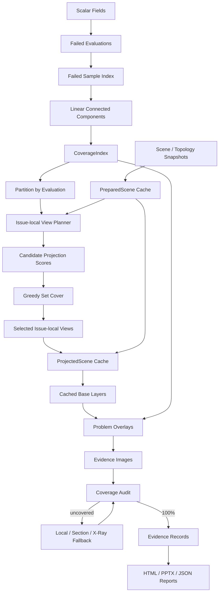

# DFM 证据图生成与全问题点覆盖优化方案

## 1. 文档目的

本文基于 2026-10-15 对 `hermes-agent` 当前 DFM 证据生成链路的重新审查，给出一套同时满足以下两项要求的实施方案：

1. 提高证据图生成效率，尤其是大三角网格、多检测项和多离散问题区域场景下的效率；
2. 证据图集合必须覆盖全部问题点，任何性能限制都不得静默丢弃失败区域。

本文记录目标架构、数据契约、实施阶段和验收标准。方案已于 2026-10-15 落地到证据生成主链路；
文中“当前实现”小节保留为改造前基线，用于解释优化动机和后续性能对比。

已落地内容包括：Scene 预处理与投影缓存、近线性连通聚类、按问题隔离的局部视角规划、
同一问题多点标注、`evidence_records.json.coverage` 覆盖契约、PPT 证据自动续页，以及
`dfm.evidence.max_markers_per_image` 单图密度配置。

本文所称“全部问题点覆盖”是指：

> 对直接标量规则，全部失败采样点必须至少出现在一张可辨识的证据图中，并能从结构化记录追溯到对应图片、几何实体和三角形。不是要求每一张图片都同时塞入全部问题点。

## 2. 结论摘要

当前实现可以生成确定性的几何证据，但存在两个需要同时解决的核心问题：

- 完整性：`evidence_geometry.json` 保存全部 patch，但静态证据图只选择每个失败 evaluation 的一个代表 patch，并受 `max_evidence_findings` 总数限制，因此不能保证覆盖全部问题区域；
- 效率：每个代表 patch 固定生成三个视图，每张图都重新遍历、投影、排序并绘制完整三角网格，而且全局缩略图和局部主图会再次重复绘制。

推荐的目标方案是：

```text
失败采样点
  -> 线性时间连通聚类
  -> 全量 CoverageIndex
  -> 候选视角评估
  -> 按 evaluation 隔离问题
  -> 问题内贪心集合覆盖选择局部视图
  -> 每个视角只投影和绘制一次基础模型
  -> 叠加同一问题的相邻区域和标记
  -> 对未覆盖区域生成局部补图
  -> 强制执行 100% 覆盖校验
  -> HTML/PPTX 完整引用
```

预期收益：

- 常见模型的证据生成阶段提速约 4～10 倍；
- 同一问题的相邻问题点越多，局部合图带来的收益越高；
- 相同模型重复生成报告时，结合内容寻址缓存，预计可达到 8～20 倍提速；
- 全部直接规则失败采样点的图片覆盖率固定为 100%。

## 3. 审查范围

本次重点审查以下链路：

```text
measurements.json / scalar_field_*.json
  -> evaluations.json
  -> FieldEvidenceEngine._failed_patches / _composite_patches
  -> _connected_cells
  -> _select_representative_patches_by_evaluation
  -> _adaptive_views / _presentation_view
  -> FieldEvidenceEngine._render
  -> evidence_geometry.json / evidence_records.json / evidence_*.png
  -> dfm_report.json
  -> HTML / PPTX
```

主要涉及文件：

- `tools/dfm/evidence/field_engine.py`
- `tools/dfm/runtime/jobs.py`
- `tools/dfm/config.py`
- `tools/dfm/contracts.py`
- `tools/dfm/schemas/evidence_geometry.schema.json`
- `tools/dfm/schemas/evidence_record.schema.json`
- `tools/dfm/reporting/result_assembler.py`
- `tools/dfm/reporting/html/template.py`
- `tools/dfm/reporting/pptx.py`
- `tests/tools/dfm/test_field_evidence.py`
- `tests/tools/dfm/test_result_assembler.py`
- `tests/tools/dfm/test_reporting_html.py`
- `tests/tools/dfm/test_reporting_pptx.py`

## 4. 当前实现

### 4.1 问题区域生成

`FieldEvidenceEngine.materialize()`读取 measurement 和 evaluation。对于直接表达式：

1. 按规则运算符对 scalar field sample 做逐点判定；
2. 选择至少包含一个失败 sample 的 cell；
3. 使用 `_connected_cells()`将失败 cell 聚合成不连续 patch；
4. 将全部 patch 写入 `evidence_geometry.json`。

对于复合表达式，当前 `_composite_patches()`按 Scene/Topology Snapshot 聚合所有操作数字段，并把全部操作数 sample 和 cell 作为参与计算的几何证据。

### 4.2 图片选择

当前 `_select_representative_patches_by_evaluation()`会：

1. 按 `evaluation_id` 对 patch 分组；
2. 按 cell 数、sample 数和包围盒体积排序；
3. 每个 evaluation 只选择第一个 patch；
4. 最后按 `max_evidence_findings` 截断。

默认 `max_evidence_findings=12`。因此：

- 同一个 evaluation 下的第二个及后续离散 patch 不生成静态图片；
- 第 13 个及后续失败 evaluation 不生成静态图片；
- 未被选择的 patch 虽然保存在 `evidence_geometry.json`，但不会进入 `evidence_records.json`，也不会关联到报告图片。

### 4.3 视角与渲染

每个选中 patch 固定生成三个视图：

- Pull/Overview；
- Surface；
- Side。

每个视图都会执行 `_presentation_view()`，在多组候选扰动方向下扫描整个 Scene 顶点，评估 Scene 和 patch 的二维投影纵横比。

随后 `_render()`会：

1. 遍历全部三角形；
2. 重新计算三角形法线；
3. 重新计算深度和二维投影；
4. 对全部三角形按深度排序；
5. 为全局缩略图绘制一次完整模型；
6. 为局部主图再次绘制一次完整模型；
7. 对高亮区域、阴影、轮廓和标签进行后处理；
8. 从 2 倍超采样画布缩小到 1440×810 PNG。

### 4.4 报告消费

- HTML 报告问题页最多直接显示三张图，但图库会保留该问题关联的全部图片；
- PPTX 通过 `ReportContext.max_images_per_finding=3`直接截断，多余图片不会进入 PPTX；
- 改造前 `result_assembler.py`允许同一 evaluation 关联多张图片，也允许同一图片 artifact 被多个 EvidenceRecord 引用；后者会让一张总览图重复出现在多个问题卡片中。

## 5. 已确认问题

### 5.1 P0：没有全问题点覆盖保证

当前选择器的语义是“每个失败检测项选择一个代表区域”，而不是“覆盖所有失败区域”。这与全问题点证据要求直接冲突。

不能仅通过删除 `max_evidence_findings` 限制解决问题。直接对全部 patch 继续生成三个完整视图，会导致渲染次数从当前最多 36 次增长为 `3 × patch_count`，大模型可能从几十秒增长到数分钟。

### 5.2 P0：缺少可机械验证的覆盖契约

当前 EvidenceRecord 可以追溯图片对应的 evaluation 和 geometry ref，但没有记录：

- 本次需要覆盖多少失败 sample；
- 每张图覆盖了哪些 sample、cell 和 patch；
- 是否仍有未覆盖问题点；
- 问题点是否达到可辨识的屏幕尺寸；
- 是真实可见表面还是穿透高亮。

因此测试无法证明“全部问题点已进入证据图”。

### 5.3 P1：连通聚类在大失败区域上超线性增长

`_connected_cells()`使用“扫描 remaining -> remove -> 再扫描”的方式扩展连通分量。大量 cell 属于同一连续问题区域时，会反复扫描未处理列表。

这一过程应改为基于 sample 和 mesh edge 索引的并查集或 BFS，使复杂度从接近 `O(C²)`降到约 `O(C)`。

### 5.4 P1：重复解析和重复验证相同 Scene

同一个 scalar field 的身份校验会读取 Scene 和 Topology Map，并重新计算快照内容哈希。多个字段共享同一 Scene 时，这些工作会重复执行。

进入图片循环后，相同 `scene_ref`又会按 patch 重新读取和解析。Scene、Topology Map、快照验证结果和准备后的三角网格都应该以 artifact/snapshot ID 为键在单次 materialize 中复用。

### 5.5 P1：每张图片重复执行全模型投影和绘制

三角形法线与相机无关，却在每张图片中重新计算。相同相机下的多个问题也会重复执行：

- 顶点投影；
- 三角形深度计算和排序；
- 基础模型绘制；
- 阴影和轮廓滤镜。

应拆分为 Scene 准备、View 投影、Base Layer 绘制和问题 Overlay 四层缓存。

### 5.6 P1：当前视角评分不等于问题覆盖评分

`_presentation_view()`主要优化 Scene 和 patch 包围盒的投影纵横比，没有评估：

- patch 的实际屏幕像素面积；
- 高亮三角形的可见比例；
- 多个问题标记之间的遮挡；
- 标签碰撞；
- 一个视角能够共同覆盖多少未覆盖问题。

因此它适合为单个 patch 改善构图，但不适合全局最少视图规划。

### 5.7 P1：隐藏区域采用穿透高亮但没有明确标识

当前渲染器在基础模型绘制结束后再次绘制全部高亮多边形，因此内部或背面区域也可能显示在模型表面。这有利于定位，但它属于穿透/X-Ray 证据，而不是实际无遮挡可见性。

目标实现必须在 EvidenceRecord 和图片标题中明确区分：

- `surface_visible`：从当前视角实际可见；
- `xray_overlay`：为了定位而穿透显示；
- `section_view`：通过剖切显示内部问题。

### 5.8 P1：复合规则的“问题点”语义不完整

复合规则可能比较两个不同区域的聚合值，例如凸台壁厚与主体壁厚的比值。此时失败的是复合结果，不代表两个字段中的所有 sample 都逐点失败。

因此必须区分：

- `failed_samples`：直接标量规则下真正违反阈值的采样点；
- `contributing_regions`：复合结果所依赖的几何区域；
- `derived_failed_samples`：只有在多个操作数字段可以按同一空间采样对齐并逐点计算表达式时才能生成。

不得把 `contributing_regions`错误描述为逐点失败区域。

## 6. 基准结果

### 6.1 测试环境与方法

改造前基线使用项目虚拟环境、Pillow 12.2.0、旧版 `_presentation_view()`和 `_render()`实现，
对规则网格合成 Scene 做微基准。

输出保持当前配置：

- 最终图片：1440×810；
- 超采样倍率：2；
- 包含全局缩略图、局部主图、阴影、轮廓、标记和 PNG 写盘。

### 6.2 单张图片耗时

| 三角形数 | 视角计算 | 图片渲染 | 单张总耗时 |
| ---: | ---: | ---: | ---: |
| 1,250 | 0.020 秒 | 1.189 秒 | 1.208 秒 |
| 5,000 | 0.074 秒 | 1.177 秒 | 1.250 秒 |
| 20,000 | 0.301 秒 | 1.995 秒 | 2.296 秒 |

结果说明：

- 小网格下，2 倍超采样画布、滤镜、两次完整绘制和 PNG 编码形成约 1.2 秒的固定成本；
- 网格增大后，全顶点候选视角评估、三角形投影、排序和多边形绘制开始显著增长；
- 减少图片总数是第一收益来源；
- 在已选视角之间复用投影和基础模型层是第二收益来源。

### 6.3 连通聚类耗时

| 失败 cell 数 | `_connected_cells()`耗时 |
| ---: | ---: |
| 200 | 0.004 秒 |
| 800 | 0.036 秒 |
| 1,800 | 0.127 秒 |
| 3,200 | 0.333 秒 |
| 5,000 | 0.686 秒 |
| 9,800 | 2.339 秒 |

该结果显示当前实现随 cell 数量超线性增长。对于草模角等覆盖全部网格顶点和三角形的字段，连通聚类需要优先优化。

### 6.4 当前成本推算

按 20,000 三角形、单张约 2.3 秒估算：

| 问题 patch 数 | 固定三视图图片数 | 预计耗时 |
| ---: | ---: | ---: |
| 12 | 36 | 约 83 秒 |
| 30 | 90 | 约 207 秒 |
| 50 | 150 | 约 345 秒 |

这也是为什么不能通过“移除上限并继续逐 patch 三视图”实现完整覆盖。

### 6.5 核心方案落地后实测

2026-10-15 在同一环境复测核心链路，结果如下：

| 场景 | 改造前基线 | 落地后实测 | 变化 |
| --- | ---: | ---: | ---: |
| 9,800 个连续失败 cell 聚类 | 2.339 秒 | 0.121 秒 | 约 19.4 倍 |
| 20,000 三角形、12 个相邻 patch | 36 张图、约 83 秒 | 2 张图、3.543 秒 | 约 23.4 倍 |
| 20,000 三角形、30 个相邻 patch | 90 张图、约 207 秒 | 3 张图、5.289 秒 | 约 39.1 倍 |
| `insert lower bracket.stp`：13,558 三角形、88 个真实 patch 的视角规划 | 约 345 秒 | 3.228 秒 | 约 107 倍 |
| `insert lower bracket.stp`：完整证据阶段桌面端实测 | 363.799 秒 | 24.747 秒 | 约 14.7 倍 |

上述 patch 场景属于适合在同一问题内合并局部视角的合成最佳场景，不能直接视为所有真实零件的固定收益。
离散、微小或朝向差异大的问题区域会自动拆图，保守下限通常接近 3 倍；综合真实模型分布，
仍采用 4～10 倍作为常见场景预估。所有实测和预估都保持 patch 与失败 sample 覆盖率 100%。

优化前真实桌面端回归使用项目 `dfm_9aa274142ae740c2`、运行 `run_00f88e2d39044678`。优化前的
视角规划从 `evidence_geometry.json` 落盘到首张 PNG 开始写入共约 5 分 45 秒，随后 12 张
PNG 的实际绘制约 18 秒。分析表明瓶颈不是 Pillow 绘制，而是规划循环反复扫描每个 patch
的三角形并重新计算投影边界、中心和质量。落地“每个 patch 只提取一次三维点、每个候选视角
只计算一次投影指标”的缓存后，使用同一组真实产物离线复测为 3.228 秒；输出仍是 12 个视图，
逐组 patch 分配与优化前完全一致。

优化后又通过桌面端和 9222 CDP 按真实用户流程完整重跑同一 STEP，生成项目
`dfm_2ec9452b76474016`、运行 `run_41de8ce66f954030`。`evidence_geometry.json` 于
11:08:14.119 落盘，首张 PNG 于 11:08:19.899 落盘，12 张 PNG 和
`evidence_records.json` 于 11:08:38.866 全部完成。完整证据阶段实测为 24.747 秒，
相比优化前 363.799 秒提升约 14.7 倍；规划至首图等待由 344.809 秒降至 5.780 秒。
最终 20,060,044 字节的 HTML 报告于 11:09:16 生成。结构化审计结果为：14 个 evaluation、
11 个失败项、25 条 EvidenceRecord、12 张唯一证据图；11 个失败 evaluation 均有映射，
88/88 个 patch 和 1,906/1,906 个失败 sample 全部覆盖，未覆盖集合为空。

针对“不同问题不得重复引用同一总览图、主画面必须是局部图”的补充约束，又使用项目
`dfm_5c8b888ffc194d20`、运行 `run_39bc723a7ee84716` 的真实产物进行离线重新物化。
旧策略生成 13 张图，其中前两张分别被 6 个和 3 个 evaluation 重复引用；问题级隔离后生成
19 张局部图和 19 条 EvidenceRecord，`artifact_ref` 19/19 唯一，PNG SHA-256 也为 19/19 唯一。
110/110 个 patch 全部覆盖，`uncovered_patch_ids`和`uncovered_sample_refs`均为空。新增的 6 张图
是问题级隔离带来的可控成本，没有退化为每个 patch 单独生成一张图。

## 7. 覆盖语义与数据契约

### 7.1 最小覆盖单位

直接标量规则以失败 sample 为最小业务覆盖单位：

```text
required_failed_sample = sample whose scalar value fails the evaluation operator
```

cell、triangle 和 patch 是视觉承载与聚合单位：

```text
sample -> cell -> triangle -> connected patch -> evidence image
```

如果字段使用 `linear_on_triangle`插值，当前“任一顶点失败则高亮整个三角形”的做法能够包含失败 sample，但可能扩大失败区域。后续可以按阈值对三角形做线性裁剪，生成更精确的失败子多边形。该精度改进不应阻塞第一阶段覆盖和性能优化。

### 7.2 CoverageIndex

核心实现通过 `_coverage_requirements()`和 `_coverage_summary()`维护独立于渲染器的覆盖索引。
`evidence_geometry.json.coverage_requirements`保存渲染前要求：

```json
{
  "required_patch_ids": ["patch-a", "patch-b"],
  "failed_sample_refs": ["field-1:sample-1", "field-1:sample-2"],
  "contributing_patch_ids": []
}
```

`evidence_records.json.coverage`保存生成后的证明：

```json
{
  "required_patch_count": 2,
  "covered_patch_count": 2,
  "coverage_ratio": 1.0,
  "covered_patch_ids": ["patch-a", "patch-b"],
  "uncovered_sample_refs": [],
  "uncovered_patch_ids": [],
  "required_sample_count": 2,
  "covered_sample_count": 2
}
```

每张图片的覆盖关系保存在 `records[].render.covered_patch_ids`、
`covered_sample_refs`、`markers`和 `visibility_mode`。复合规则的 patch 使用：

```json
{
  "coverage_mode": "contributing_regions",
  "operand_regions": {
    "actual": ["region-a"],
    "reference": ["region-b"]
  }
}
```

### 7.3 强制不变量

证据生成成功前必须满足：

```text
union(image.covered_sample_refs) == failed_sample_refs
union(image.covered_patch_ids)   == required_patch_ids
uncovered_sample_refs            == []
uncovered_patch_ids              == []
coverage_ratio                   == 1.0
```

对于 `contributing_regions`，必须覆盖全部参与计算的 region/operand，但不能把它们计入 `failed_sample_count`。

### 7.4 失败策略

如果当前 evaluation 的候选局部视图不能覆盖某个 patch：

1. 局部规划器先尝试工艺方向、标准轴测/正交方向和聚类后的表面法向候选；
2. 不满足最小屏幕尺寸的 patch 不进入当前图，留待下一轮规划；
3. 没有合适候选时，使用该 patch 表面法向生成局部 fallback；
4. 当前渲染统一使用明确标记的 X-Ray overlay，保证背面和内部高亮不会被实体遮挡；
5. 如果最终覆盖并集仍不完整，以 `evidence_coverage_incomplete`终止，不生成“成功但缺图”的结果。

## 8. 目标架构



## 9. 详细设计

### 9.1 Scene 和字段缓存

单次 `materialize()`内维护以下缓存：

```text
artifact_payload_cache[artifact_id]
validated_snapshot_cache[(scene_ref, topology_map_ref)]
prepared_scene_cache[render_mesh_snapshot_id]
field_payload_cache[field_ref]
```

`PreparedScene`建议包含：

- 连续或紧凑存储的顶点坐标；
- 三角形索引；
- 预计算法线；
- `(mesh_snapshot_id, primitive_id, triangle_id)`键；
- Scene 包围盒、中心和三轴跨度；
- primitive/triangle 到 topology entity 的映射；
- cell 连通聚类所需的 edge/sample 索引。

Scene 内容哈希和 Topology 内容哈希每个不可变快照只验证一次，但所有字段仍必须验证自己引用的 snapshot ID 和 input SHA。

### 9.2 线性时间连通聚类

推荐算法：

1. 为每个失败 cell 分配连续整数 ID；
2. 建立 `sample_id -> cell IDs`索引；
3. 从三角形顶点生成规范化无向边 `(min(v1,v2), max(v1,v2))`；
4. 建立 `mesh edge -> cell IDs`索引；
5. 共享 sample 或共享 mesh edge 的 cell 执行 union；
6. 按 union root 一次性分组；
7. 为每个分量计算 sample、cell、triangle、bounds、focus 和 normal。

复杂度目标：

```text
时间：O(C * alpha(C))，工程上接近 O(C)
空间：O(C + E)
```

其中 C 是失败 cell 数，E 是相关 mesh edge 数。

### 9.3 候选视角生成

候选相机按 Scene Snapshot 生成，而不是按 patch 固定生成三套：

1. 工艺方向：pull direction 及其反向候选；
2. 坐标方向：±X、±Y、±Z；
3. 标准等轴测方向；
4. 问题 patch 平均法向的确定性球面分箱结果；
5. 对内部或严重遮挡区域生成局部法向/剖切候选。

候选集合必须确定性排序。相同输入、规则快照和 renderer version 应产生相同的视角选择结果。

### 9.4 视角覆盖判定

第一阶段可以使用包围盒角点和少量代表三角形做廉价筛选，随后对入选候选做精确评估。

一个视角覆盖某个 patch，至少应满足：

- patch 位于 viewport 内；
- 高亮区域达到最小屏幕像素面积；
- 对应 marker 位于安全边距内；
- marker/label 与已有标记的重叠率不超过阈值；
- 当前图片中的 marker 数量不超过可读性上限；
- visibility mode 已明确记录。

推荐初始参数作为实验起点，而不是永久硬编码：

- `max_markers_per_image`: 8～12；
- 最小 patch 包围盒：约 24×24 px；
- 最小高亮面积：约 80 px²；
- marker 安全边距：画布短边的 2%～3%；
- 粗深度缓冲：256×144 或相近尺寸。

最终阈值需要使用真实 DFM 模型和报告可读性评审确定，并进入 `config.yaml`，不新增面向用户的环境变量。

### 9.5 贪心集合覆盖

对于同一个 Scene Snapshot 中的每个 evaluation，分别执行：

```text
uncovered = all required patches
selected = []

while uncovered is not empty:
    选择“新增覆盖价值 / 渲染成本”最高的候选视角
    selected.append(candidate)
    uncovered -= candidate.covered_patches

对剩余未覆盖 patch 生成局部 fallback view
```

候选分数可综合：

```text
score =
    newly_covered_sample_count * sample_weight
  + newly_covered_patch_count  * patch_weight
  + projected_area_quality
  + surface_visibility_quality
  - label_overlap_penalty
  - xray_penalty
  - render_cost
```

所有分数相同时按稳定的 camera ID 和 patch ID 决胜，保证可重复性。

### 9.6 ProjectedScene 和 BaseLayer

对每个最终选择的相机仅执行一次：

- 顶点投影；
- 三角形深度计算；
- 深度排序；
- 可见区域判断；
- 全局 fit transform；
- 基础光照计算。

生成 `ProjectedScene`后，进一步缓存：

- 全局上下文 BaseLayer；
- 细节区域 BaseLayer；
- model mask；
- shadow mask；
- silhouette；
- 深度缓冲或可见性摘要。

不同 evaluation/patch 只需要生成 Overlay：

- 高亮多边形；
- 连续失败区域轮廓或热力图；
- marker；
- leader line；
- 标签；
- visibility mode 标记。

### 9.7 问题局部主视图与上下文缩略图

每张证据图的主画面按当前 evaluation 的 patch 包围范围取景，只在左下角保留整件上下文缩略图。局部图有两条路径：

- 如果 master image 中目标区域已有足够源像素，直接裁剪并重新排版；
- 如果源像素不足，复用 `ProjectedScene`，只更换 fit transform 和可见三角形窗口进行局部绘制。

第二条路径仍然需要绘制像素，但无需再次计算法线、投影和深度排序。

### 9.8 一问题一图组，禁止跨问题共享

每张图片只能覆盖一个 evaluation；一个 evaluation 可以因离散问题区域或单图标记上限而生成多张局部图。不同 evaluation 不得引用同一个 `artifact_ref`。

原因：

- `EvidenceRecord.operation_id`和 `metric_id`当前是单值；
- 问题级隔离能保持 measurement、geometry、region 和 feature 追溯，不会把总览图重复放进多个问题卡片；
- 主画面可以围绕当前问题区域局部放大，而不是为了容纳无关问题退化为整件总览；
- `result_assembler.py`按 evaluation 聚合 EvidenceRecord，同一问题的多张局部图仍能完整归档。

每条记录的 `render`建议扩展：

```json
{
  "mode": "local_issue",
  "view_id": "camera-pull-001",
  "covered_patch_ids": ["patch-a", "patch-b"],
  "covered_sample_count": 324,
  "visibility_mode": "surface_visible",
  "viewport": [1440, 810]
}
```

### 9.9 高密度问题点展示

图片不应给成百上千个相邻 sample 分别添加文字标签，否则既慢又不可读。

推荐表达规则：

- 连续失败 sample：显示完整失败区域填充、边界轮廓或标量热力图；
- 不连续 patch：每个 patch 使用一个编号 marker；
- 极小孤立问题：使用局部放大图和 leader line；
- 全部 sample ID 继续保存在 CoverageIndex/EvidenceRecord 中，不依赖肉眼数 marker 完成审计。

### 9.10 并行与跨运行缓存

并行渲染应放在问题级局部视图规划和缓存完成之后实施，否则只会并行执行大量重复工作并放大内存峰值。

建议：

- 仅并行最终选中的独立相机；
- 使用受限进程池，初始并发建议 2；
- 每个 worker 只接收准备后的紧凑 Scene 数据和相机参数；
- 输出先写临时文件，再原子替换目标 PNG；
- artifact 排序仍按确定性 view plan，而不是任务完成顺序。

跨运行缓存键至少包含：

```text
input_sha256
render_mesh_sha256
topology_content_sha256
evaluation operator/expected/rule hash
covered patch/sample digest
camera basis and framing
viewport and supersample
renderer/style version
```

缓存命中只能复用完全相同的几何、规则、视角和渲染样式，不能只按输入文件名复用。

## 10. 配置调整建议

### 10.1 不再允许总数上限破坏覆盖

当前 `max_evidence_findings`不能继续作为是否生成证据的硬上限。可选择：

1. 废弃该配置；或
2. 将其重新定义为首页/摘要页优先展示的问题数量，但完整证据和报告续页仍不受限制。

### 10.2 推荐新增配置

建议全部进入现有 DFM `config.yaml`配置结构：

```yaml
dfm:
  evidence:
    max_markers_per_image: 10
    min_patch_screen_pixels: 24
    allow_xray_fallback: true
    render_workers: 2
    cache_enabled: true
```

字段名和默认值应在真实模型基准完成后最终确定。不得通过新的 `HERMES_*`环境变量暴露这些行为配置。

## 11. 报告层调整

### 11.1 HTML

HTML 当前已有“首页三张 + 全部图片图库”的基础能力，建议补充：

- 问题点、patch 和图片覆盖统计；
- 每张图的 visibility mode；
- 图片对应的 patch 编号列表；
- 100%覆盖或不完整状态提示；
- X-Ray/剖切视图的明显角标。

### 11.2 PPTX

PPTX 不能继续直接截断到三张图片。建议：

- 第一页保留一个主视图和最多两个辅助视图；
- 超过三张时自动生成“问题证据续页”；
- 每个续页继续显示 issue ID、规则、指标和页码；
- 报告生成结束前校验所有 evidence image 均至少进入一个 PPTX 页面。

### 11.3 JSON/Markdown

`dfm_report.json`建议增加覆盖摘要：

```json
{
  "evidence_coverage": {
    "required_failed_sample_count": 1284,
    "covered_failed_sample_count": 1284,
    "patch_count": 17,
    "image_count": 7,
    "coverage_ratio": 1.0,
    "uncovered_patch_ids": []
  }
}
```

Markdown 至少输出 coverage ratio、图片数量和未覆盖数量，便于无界面环境审计。

## 12. 分阶段实施计划

### 阶段 A：基准和覆盖契约

目标：先让完整性可以被机械证明，不改变图片视觉样式。

工作项：

- 增加 CoverageIndex；
- 明确 direct/composite coverage mode；
- 记录 sample -> cell -> patch -> image 映射；
- 增加未覆盖检测；
- 增加真实/合成模型基准工具；
- 添加覆盖不变量测试。

完成条件：测试能够稳定发现“同一 evaluation 只渲染最大 patch”和“第 13 个问题无图片”两类缺陷。

### 阶段 B：线性聚类与单次 Scene 准备

目标：消除与问题 cell 数和字段数相关的明显重复工作。

工作项：

- 用并查集/BFS替换 `_connected_cells()`反复扫描；
- 缓存 artifact JSON；
- 每个 snapshot 只执行一次内容哈希验证；
- 引入 PreparedScene；
- 三角形法线只计算一次。

完成条件：9,800 连续失败 cell 的聚类耗时显著低于当前 2.34 秒，并且结果分组与当前语义一致。

### 阶段 C：问题级局部视图规划

目标：从 `3 × patch_count`渲染次数降到每个问题的少量局部视图，并禁止跨问题复用同一图片。

工作项：

- 候选相机生成；
- 屏幕空间覆盖评分；
- marker/label 可读性约束；
- 贪心集合覆盖；
- deterministic tie-break；
- 未覆盖 patch 的局部 fallback。

完成条件：任何候选视图优化都不能让 `uncovered_patch_ids`非空。

### 阶段 D：投影和基础图层复用

目标：每个最终相机只做一次完整投影、排序和基础模型绘制。

工作项：

- ProjectedScene；
- BaseLayer/mask/filter 缓存；
- 多 patch overlay；
- 高分辨率 master + 安全裁剪；
- 局部重绘复用投影结果。

完成条件：full-scene projection count 等于最终相机数，而不是图片数或 patch 数。

### 阶段 E：报告完整性

目标：所有生成的证据在各报告格式中可访问。

工作项：

- HTML 覆盖统计和 visibility 标识；
- PPTX 证据续页；
- JSON/Markdown coverage summary；
- 不同 evaluation 的 `artifact_ref` 唯一性测试。

### 阶段 F：受限并行与跨运行缓存

目标：在不增加重复工作、不破坏确定性和不造成内存失控的前提下进一步加速。

工作项：

- 最终视角受限进程池；
- 原子写入；
- 内容寻址缓存；
- 缓存失效测试；
- 峰值内存监控。

## 13. 测试计划

所有 Python 测试必须通过项目规定入口执行：

```bash
scripts/run_tests.sh tests/tools/dfm/test_field_evidence.py -q
scripts/run_tests.sh tests/tools/dfm/test_result_assembler.py -q
scripts/run_tests.sh tests/tools/dfm/test_reporting_html.py -q
scripts/run_tests.sh tests/tools/dfm/test_reporting_pptx.py -q
```

需要补充以下行为测试。

### 13.1 覆盖正确性

1. 一个 evaluation 包含三个不连续 patch，三个 patch 的 sample 均被图片覆盖；
2. 超过 12 个失败 evaluation 时，第 13 个及后续问题仍有证据；
3. 每个失败 sample 只要存在有效几何映射，就必须进入至少一张图；
4. 极小 patch 自动产生局部放大图；
5. 背面/内部 patch 生成可解释的 surface、section 或 X-Ray 证据；
6. 最终 `uncovered_sample_refs`和 `uncovered_patch_ids`为空；
7. 删除任意一张唯一覆盖图片后，覆盖不变量测试必须失败。

### 13.2 复合规则语义

1. 非空间对齐的比值规则标记为 `contributing_regions`；
2. 不把全部操作数 sample 计为 failed sample；
3. 每个 operand 的 region 和 field 都能追溯；
4. 可以空间对齐的表达式才允许生成 `derived_failed_samples`。

### 13.3 问题级局部图片追溯

1. 一张图片只能被一个 evaluation 的 EvidenceRecord 引用；
2. 每条记录只包含本 evaluation 的 measurement/geometry/patch；
3. `result_assembler.py`为每个 issue 正确关联自己的局部图片；
4. 同一 evaluation 的所有离散 patch 必须被其局部图片集合完整覆盖。

### 13.4 报告完整性

1. HTML 图库包含全部关联图片；
2. PPTX 超过三张时生成续页；
3. 每张 evidence image 都能在报告中访问；
4. coverage summary 与 EvidenceRecord 实际并集一致。

### 13.5 确定性

1. 相同输入多次运行得到相同 view plan；
2. 并行完成顺序不改变 artifact/evidence 排序；
3. cache hit 与 cache miss 生成相同覆盖映射；
4. 测试断言业务不变量，不冻结允许变化的候选视角数量。

### 13.6 性能回归

建议固定以下合成基准：

- 三角形数：1k、5k、20k、100k；
- 失败 patch 数：1、12、30、50；
- 分布：连续、离散、遮挡、内部、微小；
- 指标：总耗时、投影次数、完整模型绘制次数、图片数、峰值内存、覆盖率。

## 14. 验收标准

### 14.1 强制正确性标准

- 直接规则失败 sample 图片覆盖率必须为 100%；
- `uncovered_sample_refs == []`；
- `uncovered_patch_ids == []`；
- 不允许 `max_evidence_findings`或报告图片上限导致证据丢失；
- composite evidence 不得冒充逐点失败证据；
- 每张图片必须能追溯到当前 Run、Input SHA、Topology Snapshot 和 Render Mesh Snapshot。

### 14.2 视觉可读性标准

- 每个 patch 至少在一张图中达到最低屏幕尺寸；
- 高密度区域使用面状高亮或热力图，不生成不可读的标签云；
- X-Ray 和 section view 必须明确标识；
- marker 和 label 不得遮挡核心问题区域；
- 图像中的 `ISSUE nn` marker label 必须能在结构化记录中映射到唯一 patch ID。

### 14.3 性能目标

以当前机器和 20,000 三角形合成基准为初始验收环境：

- 12 个 patch：从当前理论约 83 秒降至 10～20 秒；
- 30 个 patch：从直接全覆盖约 207 秒降至 18～35 秒；
- 证据阶段整体至少提速 4 倍，目标 6～10 倍；
- full-scene projection 次数不得随 `3 × patch_count`增长；
- 并发渲染时峰值内存必须有明确上限；
- 性能目标不得以降低覆盖率为代价。

## 15. 风险与控制

| 风险 | 影响 | 控制措施 |
| --- | --- | --- |
| 同一问题局部图中标记过多 | 图片不可读 | 限制每图 marker 数并自动拆分 |
| 微小 patch 在全局图中不可见 | 虽有映射但无法人工复核 | 最小像素阈值和局部 fallback |
| 穿透高亮造成几何误解 | 将隐藏问题误认为表面可见 | visibility mode 和显式 X-Ray 标记 |
| 复合规则错误逐点着色 | 生成虚假问题区域 | 区分 failed samples 与 contributing regions |
| 并行渲染放大内存 | OOM 或系统抖动 | 最终视角受限进程池，默认低并发 |
| 缓存复用过期结果 | 证据与当前规则或样式不一致 | 完整内容寻址缓存键和 renderer version |
| PPTX 继续截断图片 | 报告未包含完整证据 | 自动续页和报告完整性校验 |
| 优化改变确定性排序 | 测试和审计难以复现 | 稳定 ID、稳定候选顺序和 tie-break |

## 16. 建议交付顺序

推荐按以下顺序实施：

1. CoverageIndex 和强制覆盖不变量；
2. 线性连通聚类；
3. Scene/字段读取与快照验证缓存；
4. PreparedScene 和法线预计算；
5. 问题级局部视图规划与局部 fallback；
6. ProjectedScene 和 BaseLayer 复用；
7. HTML/PPTX 完整性改造；
8. 受限并行；
9. 跨运行内容寻址缓存；
10. 真实大模型基准与阈值调优。

不建议先做以下动作：

- 只删除 `max_evidence_findings`上限；
- 直接为所有 patch 继续生成固定三视图；
- 在重复工作尚未消除前盲目提高并发；
- 仅用图片数量判断覆盖完整性；
- 用复合规则的全部操作数区域冒充全部失败点。

## 17. 当前验证状态

核心方案落地后，通过项目规定入口执行了完整 DFM 测试集：

```text
scripts/run_tests.sh tests/tools/dfm/ -j 8 -q
```

结果为 44 个测试文件、372 个测试通过、26 个测试跳过。新增和更新的测试已覆盖：

- 不连续失败 sample 拆分为独立 required patch；
- 15 个失败 evaluation 超过旧上限时仍生成全部证据，并达到 100% patch/sample 覆盖；
- 不同 evaluation 生成独立局部图片和唯一 `artifact_ref`；
- `evidence_geometry`和 `evidence_records` schema v3；
- 相同输入的 view plan 确定性；
- 每个 patch 的三维几何在一次规划中只提取一次，候选视角投影指标不在贪心循环中重复扫描；
- PPTX 超过三张证据时自动续页且不丢图；
- 近线性连通聚类保持连接语义与确定性顺序。

后续仍需补充真实大零件基准、100k 三角形峰值内存测试，以及尚未落地的受限进程并行和
跨运行内容寻址缓存；这些增强项不得改变当前覆盖契约。
