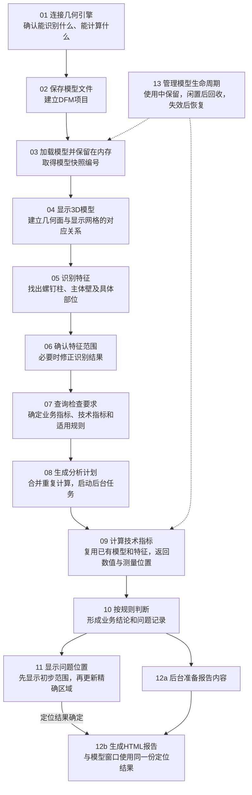

# DFM 分析主流程：模型复用与技术指标统一

方案状态：目标设计，待实施。更新日期：2026-10-14。

## 主流程



问题定位与报告内容准备并行进行。用户先看到分析结论和高亮位置，随后收到 HTML 报告；模型资源管理贯穿整个过程。

## 分析对象与职责分工

分析对象是一件塑料壳体，壳体上有一个带盲孔的螺钉柱。需要检查：这个螺钉柱的柱壁厚度是否符合要求。

| 对象 | 含义 | 本例编号或名称 |
| --- | --- | --- |
| 特征 Feature | 模型中的一个具体结构 | 螺钉柱 `BOSS_0007`、主体壁 `MAIN_WALL_0001` |
| 业务指标 Check | 要判断的业务问题 | 螺钉柱的“柱壁”是否符合要求 |
| 技术指标 Geometric | 为作出判断，需要计算的几何量 | 柱壁最大厚度、邻近主体壁参考厚度 |
| 规则 Rule | 如何使用这些数值判断合格 | 厚度比的计算公式和允许范围 |

两个技术指标分别使用以下编号，两端保持一致：

| 简称 | 技术指标 ID（geometric_id） | 测量含义 |
| --- | --- | --- |
| G1 | `G_SCREW_BOSS_WALL_THK_MAX` | 这个螺钉柱的柱壁最大厚度 |
| G2 | `G_SCREW_BOSS_WALL_REF_THK` | 以这个柱为定位依据，选取邻近主体壁的参考厚度 |

职责分为三部分：

| 组件 | 负责什么 |
| --- | --- |
| OCCT Worker | 加载模型、识别结构、计算技术指标、返回测量位置 |
| Hermes | 查询规则、组织计算、判断是否有问题、生成报告 |
| Desktop | 展示模型、接收用户确认、显示问题和报告 |

**Worker 回答“这里多厚”，Hermes 回答“这个厚度是否符合要求”。**

## 01 连接几何引擎：先确认可以做哪些分析

Hermes 启动 `dfm-geometry.exe` 的常驻进程，并读取它的能力清单（Capabilities）。这一步不读取 STEP，也不执行测量。

能力清单相当于几何引擎的“功能目录”。对于柱壁检查，Hermes 要确认：

| 确认内容 | 本例要求 |
| --- | --- |
| 能识别哪些结构 | 螺钉柱、主体壁 |
| 能计算哪些技术指标 | G1 柱壁最大厚度、G2 邻近主体壁参考厚度 |
| 每个指标怎么定义 | 测哪个部位、取最大值还是其他统计值、使用什么单位 |
| 计算还需要哪些输入 | 例如拔模角需要已确认的脱模方向 |

新接口直接用 `geometric_id` 表达能力、请求和结果。Hermes 不再把一个技术指标转换为多组 `operation_id`、`metric_id`、`quantity_id` 才能调用；算法名称和调度细节留在 Worker 内部。

常驻方式采用 `dfm-geometry serve --stdio`：Hermes 通过进程管道发送 JSON 消息，Worker 完成一次请求后继续等待下一次请求，不立即退出。诊断日志走独立通道，避免混入结果消息。

能力清单由实际算法注册信息生成。缺少某个指标时，Hermes 明确提示无法完成哪些检查；有对应算法，也仍可能因模型形状不适用而无法计算。

## 02 保存模型文件：让分析不依赖聊天附件

Hermes 将上传的 `壳体A.stp` 保存到 DFM 项目中，并记录文件内容指纹、单位和工艺。内容指纹用于区分“同名文件”和“同一份文件”。

后续预览、识别、计算都引用项目中的这一份输入。用户切换聊天，或者临时附件失效，不会使项目找不到原始模型。

本例建立项目 `PROJECT_A`。它长期保存模型、特征确认记录、历次分析结果和报告；聊天只是进入这个项目的一种方式。

## 03 加载模型：一次读入，多次使用

Worker 读取 STEP，检查几何有效性，统一单位，并给面、边建立索引。准备完成后返回 `snapshot_id`，供后续请求引用。

**模型快照不是截图，而是“这份模型及特征状态”的编号。** Hermes 拿着编号发请求，Worker 据此找到内存中的数据。

```text
常驻 Worker 进程
  └─ 模型 A
       ├─ 几何模型：真实的曲面、边和实体
       ├─ 计算资源：面之间的邻接关系、空间查询索引等
       ├─ 特征记录：哪些面组成螺钉柱，哪些面是主体壁
       └─ 已有结果：已计算的厚度、孔深及测量位置
```

几何模型由 `LoadedModel` 持有，计算资源由 `GeometryContext` 管理，特征记录保存在 `FeatureStore`。会话管理器负责保留这些对象，使它们不随单次请求结束而释放。

旧流程与新流程的区别在于保留了什么：

| 数据 | 旧流程：一次请求结束，进程退出 | 新流程：模型仍在使用，进程常驻 |
| --- | --- | --- |
| 磁盘上的 `features.json` | 保留，Hermes 可以读取 | 保留，用于记录和恢复 |
| 内存中的 FeatureStore | 销毁 | 保留，下一次计算直接查询 |
| OCCT 几何模型及计算资源 | 释放，下次测量重新建立 | 保留，后续识别和测量共用 |

`features.json` 只是特征记录的文件副本。例如它可以记录“外壁是 face-101”，但不等于保存了可直接求交的 OCCT 曲面对象。读取文件不能代替模型内存复用。

健康会话中，同一份模型从预览到多批指标计算只需导入一次。若 Worker 已重启或快照已被回收，则需要重新打开模型，取得新快照。

## 04 显示模型：把几何面转换为可绘制的三角形

OCCT 用曲面和边描述模型，浏览器用大量小三角形绘制模型。因此，Worker 在生成预览时，还要保存“几何面对应哪些三角形”的映射，称为 `topology_map`。

```text
真实几何面                         显示网格
螺钉柱外壁 face-101 ──映射──→ 三角形 10、11、12、13
螺钉孔内壁 face-103 ──映射──→ 三角形 20、21、22
```

之后选中外壁，前端就能通过映射找到对应三角形并着色，而不需要重新识别结构。

同一张面换成更细的网格后，三角形编号可能完全不同。因此，几何面引用带 `topology_snapshot_id`，显示网格带 `render_mesh_snapshot_id`，高亮必须使用相匹配的映射。

模型几何没有变化时，特征审核、问题展示和 HTML 报告共用这份网格与映射，不重复生成大模型预览。

## 05 识别特征：从一组面中找出完整结构

Discovery 是特征识别阶段。它解决的是“这是什么结构、由哪些面组成”，此时还不判断是否违反业务规则。

对于螺钉柱，Worker 结合曲面类型、轴线、面之间的连接关系，找到柱体和孔，并区分具体部位。识别结果保存在 FeatureStore 中：

```text
BOSS_0007：带盲孔的螺钉柱
  ├─ 自身部位
  │    ├─ 外壁             → face-101
  │    ├─ 孔内壁           → face-103
  │    ├─ 顶部环面         → face-104
  │    ├─ 盲孔孔底         → face-105
  │    ├─ 外根部圆角       → face-106
  │    └─ 孔底圆角         → face-108
  └─ 关联部位
       └─ 邻近主体壁       → MAIN_WALL_0001 中的 face-201、face-202
```

FeatureStore 是内存中的结构化记录集合，作用类似“特征目录”：通过 `BOSS_0007` 能查到这个柱的部位和关联面，再由几何模型取得实际曲面。

邻近主体壁不属于柱体自身，但它是计算参考厚度的依据。同一个主体壁上有多个柱时，每个柱可能对应不同的局部参考范围，不能统一用整件平均壁厚代替。

未被螺钉柱等结构占用的面，可以作为主体壁候选；仍需检查几何关系，不能把所有未识别面直接当作有效的壁厚参考面。

识别完成后，Worker 返回特征清单和显示位置，Hermes 通知用户并展示审核界面。特征部位保留在 Worker 中，普通测量不再要求 Hermes 另建 Region、反复提交面号。

## 06 确认特征范围：计算使用用户认可的结构

用户在模型上检查识别结果。确认无误，直接使用当前快照；如果发现漏选或选错，可以修正特征范围。

例如，柱外壁漏掉了 `face-102`。用户补选后，Worker 校验该面属于当前模型、连接关系合理，再保存新的特征版本。

```text
snapshot_A0：模型已加载，尚未识别
snapshot_A1：自动识别结果，外壁为 face-101
snapshot_A2：修订后结果，外壁为 face-101、face-102
       └─ 三个快照共享同一个几何模型，不重新读取 STEP
```

后续分析固定使用 `snapshot_A2`。即使用户再次修改特征，已经启动的分析也不会中途换用新范围；历史结果仍能查到当时使用的版本。

这里修改的是“哪些面属于哪个部位”，不是修改 CAD 几何。若模型本身发生变化，应作为新输入重新加载。

## 07 查询规则：确定要检查什么、需要算什么

Hermes 根据已确认的特征类型查询本体规则库，将业务要求转换为技术指标需求。

```text
螺钉柱 BOSS_0007
  └─ 业务指标：柱壁
       ├─ 需要 G1：柱壁最大厚度
       ├─ 需要 G2：邻近主体壁参考厚度
       └─ 适用规则：规定计算公式、比较方式和允许范围
```

Check 是业务问题，Geometric 是测量量，两者不是一一对应。一项 Check 可以需要多个 G，同一个 G 也可以被多个 Check 使用。

公式通过变量名引用技术指标，这个绑定称为 Operand：

| 公式中的变量名 | 取值来源 |
| --- | --- |
| `boss_wall_thickness` | G1 柱壁最大厚度 |
| `adjacent_main_wall_thickness` | G2 邻近主体壁参考厚度 |

规则中有两类不同的条件：

| 字段 | 作用 | 例子 |
| --- | --- | --- |
| `conditions_json` | 决定采用哪条规则 | 材料类别、纹理等适用条件 |
| `acceptance_criteria_json` | 决定是否合格 | 两个厚度的比值是否在允许范围内 |

缺少材料等信息时，Hermes 向用户确认。Factor 是要收集的信息项，Fact 是已确认的具体值，例如“材料类别”与“ABS”。所选规则版本、输入来源一起保存。

公式和业务阈值留在 Hermes。Worker 只接收计算本身需要的信息，例如拔模角所需的方向，不接收“超过多少算问题”的要求。

## 08 生成分析计划：先去重，再交给后台执行

分析计划 Plan 是本次任务的执行依据。Hermes 固定以下内容，避免分析过程中输入或规则发生变化：

| 固定内容 | 本例 |
| --- | --- |
| 模型与特征版本 | `snapshot_A2` 中的 `BOSS_0007` |
| 检查要求 | 柱壁 Check、所选规则版本、公式与阈值 |
| 计算需求 | G1、G2 及各自需要的计算参数 |
| 运行记录 | 一次独立的分析 `RUN_A1`，关联进度、结果和报告 |

若两个业务检查都需要同一柱、同一计算条件下的 G2，计划只安排一次测量，再将结果提供给两个检查使用。不同指标即使都叫“参考厚度”，也要确认参考部位和取值方法相同，才能合并。

Hermes 的 JobManager 负责将计划放入后台任务，管理进度、完成和失败状态。用户可以继续操作界面，不必等待一个长时间的同步调用。

## 09 计算技术指标：按特征找部位，按指标选算法

Hermes 向 Worker 发送模型快照、特征编号和技术指标编号。模型文件、特征面清单不再随每次计算重复传输。

```json
{
  "snapshot_id": "snapshot_A2",
  "items": [
    {
      "feature_id": "BOSS_0007",
      "geometric_ids": [
        "G_SCREW_BOSS_WALL_THK_MAX",
        "G_SCREW_BOSS_WALL_REF_THK"
      ],
      "context": {}
    }
  ]
}
```

`context` 保存该项计算需要的输入和参数。这组厚度计算没有额外输入；拔模角计算则需要按能力声明提供已确认的方向。

Worker 的处理顺序是：

```text
snapshot_A2 → 找到模型 A 和已确认的特征记录
BOSS_0007   → 找到这个螺钉柱
G1         → 选择柱外壁和孔内壁 → 计算柱壁厚度 → 取最大值
G2         → 选择关联的局部主体壁 → 计算参考厚度
```

### 柱壁厚度怎么计算

对当前算法支持的同轴柱体，Worker 在柱外壁选取采样点，沿朝向柱轴的方向寻找孔内壁，测量两个交点之间的距离。只有首次命中确实属于该柱孔壁的有效配对才计入结果。

```text
柱外壁采样点 P ─── 穿过柱壁材料 ─── 孔内壁交点 Q
                         P 到 Q 的距离 = 此处柱壁厚度
```

算例采样值为 1.2、1.8、2.1 mm，最大值为 **2.1 mm**。Worker 同时保存采样位置和厚度，用于解释最大值来自哪里、定位局部问题。采样最大值的精度受采样密度与覆盖范围影响。

邻近主体壁使用该柱关联的局部范围测量。当前模块沿壁面向内法向取有效厚度样本，再取中位数；样本为 2.9、3.0、3.1 mm 时，参考厚度为 **3.0 mm**。这一取值方法需与技术指标的工程定义一致。

### 结果怎么返回、怎么复用

结果按 G 分别返回，带有快照、特征、有效计算参数、状态、数值、单位和测量位置。Hermes 按这些标识关联结果，不依赖返回顺序。

| 返回的 geometric_id | 数值 | 单位 | 测量位置 |
| --- | --- | --- | --- |
| `G_SCREW_BOSS_WALL_THK_MAX` | 2.1 | mm | 柱壁测量点、支撑面和局部厚度数据 |
| `G_SCREW_BOSS_WALL_REF_THK` | 3.0 | mm | 邻近主体壁的参考位置 |

不能计算的指标返回具体原因，不用 0 代替。批次 `job_id` 用来跟踪进度和取消任务，不是新的技术指标编号。

| 后续请求 | 处理方式 |
| --- | --- |
| 同一快照、同一特征、同一 G、相同计算条件 | 复用已有数值和测量位置 |
| 改了业务阈值 | 复用测量结果，由 Hermes 重新判断 |
| 改了特征范围、相关方向或采样精度 | 重新验证或计算受影响的结果 |
| 继续计算孔深、孔径、指定部位圆角 | 使用同一模型和特征，按各 G 选择部位与算法 |

孔深和孔径可以共享孔壁分析；外根部圆角与孔底圆角也可以复用半径算法。但它们测量的部位不同，对外仍是不同的技术指标。

初版同一模型的几何任务排队计算；多模型并发通过有上限的进程池调度。模型常驻解决重复加载问题，不等于无限并发。

## 10 执行规则：两个测量值形成一个业务结论

Hermes 校验测量结果后，将 G1、G2 填入规则公式，按本次固定的规则版本判断。

**柱壁检查算例**

| 项目 | 内容 |
| --- | --- |
| 柱壁最大厚度 | 2.1 mm |
| 邻近主体壁参考厚度 | 3.0 mm |
| 算例合格条件 | 柱壁最大厚度 / 邻近主体壁参考厚度 ≤ 0.60 |
| 运算结果 | 2.1 / 3.0 = 0.70 |
| 业务结论 | 0.70 大于 0.60，柱壁检查不通过 |

这里得到的是 **一个柱壁问题**，两个技术指标是判断依据，不是两个问题。正式分析的公式和阈值由所选规则提供，程序不自行增减判定条件。

若规则同时要求绝对厚度和厚度比达标，就在同一判定组中执行两个条件，全部满足才通过；有多个备选判定组时，任意一组满足即可。

缺失测量值、除数为零或单位不匹配时，对应条件无法判断。整体结论仍按条件组判断：已有完整通过组可以通过；所有组都已确定失败才判不通过；其余无法确定的情况单独显示“未评估”，不能当作合格。

判定记录保存使用了哪些数值和规则；不通过的 Check 形成问题记录 Finding。界面与报告按业务问题类型统计，例如柱壁、拔模角、圆角，暂不按高中低风险划分。

## 11 显示问题位置：先给范围，再给局部区域

Hermes 一旦得到不通过的结论，就向 Desktop 发布问题和已有定位，不等待 HTML 报告。

测量证据 `evidence` 有三个层次：

| 数据 | 能说明什么 | 用途 |
| --- | --- | --- |
| 面、边引用 | 测量涉及哪些几何部位 | 先定位问题所在的范围 |
| 测量点或线段 | 某个数值在哪里测得 | 显示最大厚度对应的位置 |
| 局部采样值 | 每个采样位置的厚度 | 结合规则筛选局部不合格区域 |

本例参考厚度固定为 3.0 mm，可以对柱壁各采样位置分别计算厚度比：

| 位置 | 柱壁厚度 | 厚度比 | 算例判断 |
| --- | --- | --- | --- |
| P1 | 1.2 mm | 0.40 | 满足要求 |
| P2 | 1.8 mm | 0.60 | 满足要求 |
| P3 | 2.1 mm | 0.70 | 超出要求 |

```text
Worker 返回厚度与位置
          ↓
Hermes 按规则找到超出要求的采样位置
          ↓
利用面与网格映射，将这些位置转换为显示区域
          ↓
Desktop 更新高亮，HTML 使用同一份定位结果
```

只有部位范围时显示黄色“初步定位”；局部证据足够后更新为红色，并提示“精确区域已更新”。颜色表示定位状态，不表示问题严重度。

主体壁是本例的参考对象，不因为参与计算就被全部标红。若采样不足，或规则无法直接转换为局部判断，保留初步范围并说明原因，不把整面冒充精确问题区域。

定位结果绑定本次分析使用的几何、网格和证据版本。换网格时重新映射，避免同一问题在 Desktop 和报告中高亮到不同位置。

## 12 异步生成报告：整理已有结果，不重做分析

报告使用本次分析保存的特征、测量值、规则结论和定位结果。Agent 将这些数据整理为可读说明，JobManager 在后台完成 HTML 渲染并推送进度。

```text
规则判断完成
  ├─ Desktop：立即显示问题 → 更新定位
  └─ 后台报告：准备内容 → 取得已确定的定位结果 → 渲染HTML → 通知用户
```

报告中的柱壁问题包括：检查对象、2.1 mm 与 3.0 mm 两个测量值、厚度比 0.70、适用要求，以及对应的三维位置。

报告不再次导入 STEP，也不单独生成另一套高亮区域。最终 HTML 与模型窗口引用同一份已确定的定位结果；若只能初步定位，两处都保留相同标注。

报告生成失败只影响报告任务，可以基于已有分析结果重试，不撤销已经完成的测量和业务结论。

## 13 管理模型生命周期：切换聊天不等于清空模型

聊天、项目和模型快照是不同对象：

| 标识 | 管理什么 | 什么时候结束 |
| --- | --- | --- |
| 聊天会话 ID | 一段用户对话 | 用户结束或切换聊天 |
| `project_id` | 模型、历次分析及报告 | 项目长期保留 |
| `snapshot_id` | Worker 内存中的模型与特征状态 | 主动释放、闲置回收或进程退出 |

```text
聊天 A → 项目 A → snapshot_A2 → 模型 A / BOSS_0007
聊天 B → 项目 B → snapshot_B1 → 模型 B / BOSS_0007
```

即使两个模型都有 `BOSS_0007`，配合不同的 `snapshot_id`，Worker 也能区分它们。新聊天继续项目 A 时，Hermes 从项目记录找到快照，确认有效后继续使用。

Hermes 在用户审核、等待补充信息、执行计算期间续租，即定期告诉 Worker“这份模型仍在使用”。活动任务也持有自己的引用，不能因为聊天关闭就释放正在计算的模型。

没有使用者后，Worker 按空闲时间和内存预算回收资源。原始模型、特征文件、分析记录和报告仍保存在项目中。Worker 重启后内存快照失效，Hermes 重新加载模型、校验并恢复特征修订，再取得新快照，不能直接沿用旧面号。

本地方案不依赖 Redis。Redis 可以保存 JSON、测量结果或任务状态，但不能直接保存可供另一个进程使用的 OCCT 内存对象，不能替代常驻 Worker。

## 关键变化与落地验证

| 修改点 | 直接效果 | 验证方式 |
| --- | --- | --- |
| 两端统一使用 G ID | 能力、请求、结果说的是同一个技术指标 | 按 G 核对定义、部位、单位和返回值 |
| 模型与特征跨请求保留 | 大文件不反复导入，识别不反复执行 | 预览、识别、柱壁及孔深计算的正常流程中，STEP 导入一次 |
| Worker 内部选择特征部位 | Hermes 不再为普通测量拼 Region 和面号 | 修订后的部位确实参与后续计算 |
| 相同技术指标复用 | 多个业务检查不重复测量 | 同一计算条件下，同一个 G 只实际求解一次 |
| 定位与报告分开执行 | 先看到问题，后收到报告 | 报告耗时或失败时，已有问题仍可查看 |
| 共享网格与定位版本 | 模型窗口和报告位置一致 | 对同一分析结果比对两处高亮 |

实施顺序：**确定契约 → 实现并验证 Worker → 编译发布 → 接入 Hermes → 联调 Desktop 与报告。**

算法接入还需核对两点：螺钉柱拔模当前使用柱轴，需改为按指标定义消费已确认的脱模方向；顶部、外根部、孔底圆角需分别核对位置和正式输出能力，不能把已有诊断值等同于已发布指标。

Hermes 的调用、计划及结果处理设计见[Hermes Geometric 契约接入与模型会话管理](dfm-geometric-session-contract.md)。
