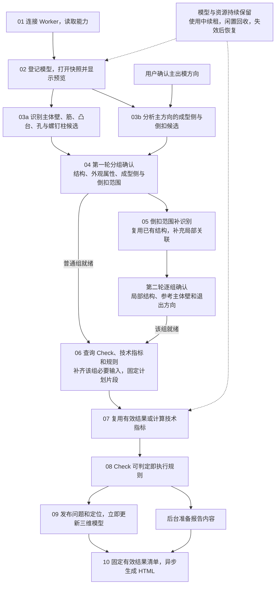

# DFM 系统架构与主流程

状态：目标设计，常驻会话与两轮分组编排待实施。更新：2026-10-19。

## 主流程



结构识别不必等主方向；方向分析必须使用已确认方向。确认一组就推进一组，一个倒扣组缺方向不阻塞其他组。图中的独立分支不表示可以同时访问同一个 OCCT 上下文：首版同模型几何任务排队执行。

## 系统由谁负责

| 组件 | 负责的工作 | 不负责的工作 |
| --- | --- | --- |
| Desktop | 上传、三维展示、用户确认、问题列表和报告预览 | 自行计算指标或选择阈值 |
| Hermes | 保存项目、查询规则、组织计算、确定性判定、问题与报告 | 用大模型编造几何值或工程事实 |
| OCCT Worker | 加载模型、识别结构与部位、几何计算、测量证据 | 选择业务合格阈值、判断风险等级 |
| Mold 本体规则服务 | 维护概念、规则及知识引用，审核和发布 | 直接修改某个分析中的模型与结果 |

Hermes 下载已发布规则并安装为本地只读 SQLite，不直接连接 Mold 的管理数据库。知识库和 AI 辅助解释、规则起草与报告整理，不能替代几何计算和确定性规则执行。

二维图纸是补充输入：程序提取 OCR 原文及位置，当前 Agent 提议工程事实和二维／三维关联，程序校验来源与版本，几何模块验证关联。无法确认的关联保留歧义，不自动变成已确认事实。

## 贯穿实例：检查一个螺钉柱的柱壁

塑料壳体上有一个带盲孔的螺钉柱 `BOSS_0007`，它连接主体壁 `MAIN_WALL_0001`。本例检查柱壁厚度与相邻主体壁厚度的比例。

| 概念 | 通俗含义 | 本例 |
| --- | --- | --- |
| Feature | 模型中一个具体结构 | 螺钉柱 `BOSS_0007` |
| Check | 要回答的业务问题 | 这个柱的柱壁是否符合要求 |
| Geometric，简称 G | 为判断问题而测量的技术指标 | 柱壁最大厚度、邻近主体壁参考厚度 |
| Operand | 规则公式中的变量及其 G 绑定 | `boss_wall_thickness` 对应柱壁最大厚度 |
| Factor／Fact | 需要的信息项／确认的具体值 | 材料／ABS |
| Rule | 适用条件、公式和阈值 | 厚度比应落在哪个范围 |
| Snapshot | Worker 中一份模型及特征状态的引用 | 不是截图，也不是规则发布包 |

本例两项技术指标分别为 `G_SCREW_BOSS_WALL_THK_MAX` 和 `G_SCREW_BOSS_WALL_REF_THK`。能力、请求和结果直接使用同一 G ID；算法函数名留在 Worker 内部。

## 01 读取能力：先知道引擎能做什么

Hermes 启动本地 `dfm-geometry.exe` 常驻进程，通过管道读取能力清单。此时不加载 STEP。能力清单说明能识别哪些结构、计算哪些 G，以及范围、方向和输入要求。

柱壁检查需要同时具备上述两项厚度能力。缺少任一能力，就明确列出未覆盖原因，不能把“没有运行”显示成合格。

实现细节：[会话接入 §2—3](dfm-geometric-session-contract.md#2-共同契约与-hermes-的使用方式)。

## 02 登记并打开模型：一次加载，多次使用

Hermes 将附件复制到项目、记录哈希，再让 Worker 打开模型。Worker 保留三类内存对象：真实几何模型、共享计算资源、结构化特征记录。

```text
项目输入 STEP
  → Worker 中的模型
      ├─ 曲面、边、实体
      ├─ 邻接与空间查询资源
      └─ FeatureStore：结构实例、内部部位和关联
  → snapshot_id：后续请求用它找到这一状态
```

预览、识别和后续测量使用同一份已加载模型。磁盘 `features.json` 只是记录副本，不能代替内存中的 OCCT 曲面；进程退出后必须重新建立模型并校验恢复材料。

浏览器显示三角形，OCCT 计算曲面；`topology_map` 连接这两套表示。例如一张柱外壁对应多个三角形。换网格后要重新映射，不能继续使用旧三角形编号。

实现细节：[会话管理 §4](dfm-geometric-session-contract.md#4-两轮分组确认与增量快照)。

## 03 识别候选：先分清结构、用途和成型范围

Worker 一支识别孔、筋、凸台等结构，再组合出空心柱、支撑筋和承载壁；另一支依据用户主方向分析可见性、成型侧和倒扣候选。

螺钉柱记录包含外壁、孔壁、孔底、根部圆角，以及邻近主体壁和支撑筋关联。圆柱形状本身不能证明螺钉用途；外观面也属于产品用途，需要可靠属性或用户确认。

型芯侧、型腔侧是产品表面的成型归属候选，不等于已经构造了模具实体。未识别面保留未分类检查范围，不能一概归为主体壁。

识别同时报告搜索是否完整。筋识别失败不等于支撑筋数量为零；局部孔清单不完整，也不能发布最终最近孔距。

部位和配对定义：[Feature—Check—G 映射](注塑件%20DFM%20A类特征区域与%20Check-Geometric%20映射%20V1.0.md)。

## 04—05 两轮确认：先普通组，再逐个倒扣组

| 阶段 | 用户确认什么 | 确认后推进什么 |
| --- | --- | --- |
| 第一轮 | 主体壁、普通结构、外观属性、成型侧、倒扣候选范围 | 已就绪普通组直接计算；倒扣范围补识别 |
| 第二轮 | 每个倒扣组内的结构、参考主体壁、局部退出方向 | 该组局部计算，不等待其他组 |

假设有 `SIDE_01`、`SIDE_02` 两组倒扣：SIDE_01 缺方向时，SIDE_02 仍可继续。结构已确认但方向未确认时，厚度、尺寸、圆角可以先算，方向相关任务继续等待。

局部识别复用已有孔、筋和柱的实例，不重复计数；局部范围外的参考主壁与遮挡物仍从完整模型查询。局部方向通过也不抹掉主方向下的倒扣事实。

用户修改内容后，相关确认和结果需要重新验证；异步分支通过受校验的快照合并保留修订，不能用最后返回的结果覆盖当前状态。

实现细节：[分组确认与快照合并](dfm-geometric-session-contract.md#4-两轮分组确认与增量快照)。

## 06 查询规则并组织计划：只计算当前需要的指标

```text
已确认 BOSS_0007
  → 查询柱壁 Check
  → 取得两个厚度 G 及变量绑定
  → 按材料等 Fact 选择规则
  → 固定该组计划片段，合并相同计算需求
```

Run 固定模型输入和规则发布版本。普通组、SIDE_01、SIDE_02 分别就绪时追加不可变计划片段；修改则追加替代片段，保留历史。

同一个柱的参考壁厚被多个 Check 使用时，只提交一次有效需求。公式和阈值留在 Hermes，不随任务交给 Worker。

字段与求值：[本体规则契约](dfm-rule-catalog-database-design.md)。调度与复用：[会话接入 §5—6](dfm-geometric-session-contract.md#5-分阶段计划与任务依赖)。

## 07 测量技术指标：按结构找部位，按 G 定义计算

Hermes 发送模型快照、特征实例、G ID 和必要 context。Worker 根据 G 定义选择部位和算法：

```text
BOSS_0007 + 柱壁最大厚度 G → 外壁与孔壁配对 → 厚度采样 → 最大值
BOSS_0007 + 参考壁厚 G     → 关联的局部主体壁 → 有效厚度 → 约定统计值
```

两者不是随意取面距，也不能把全件平均壁厚当作每个柱的参考值。数值、单位、实际选中对象和测量位置一并返回；无法计算时返回原因，不填零。

有效结果可复用。只改 SIDE_01 方向，不应重算其他组的厚度；跨快照复用要验证真实依赖，不是只比较 Feature 编号。

测量定义：[映射文档的螺钉柱实例](注塑件%20DFM%20A类特征区域与%20Check-Geometric%20映射%20V1.0.md#2-用螺钉柱还原完整模型)。

## 08 执行规则：两个技术指标形成一个业务结论

假设本例测得柱壁最大厚度 2.1 mm、参考壁厚 3.0 mm，所选规则要求比值不大于 0.60，则 `2.1 / 3.0 = 0.70`，形成一个“柱壁”问题，不是两个技术指标问题。实际公式和阈值始终来自所选规则。

一个 Check 可包含多个条件：组内全部满足，多个备选组任意一组满足即可。缺值按条件组保留无法判定状态，不能默认通过。问题按业务类型统计，暂不按高中低风险分组。

详细求值：[本地规则执行](dfm-rule-catalog-database-design.md#55-rule_version)。

## 09—10 展示与报告：问题先出现，报告后台完成

Check 能判定就发布问题，不等待全部区域和 HTML。只有部位范围时显示黄色“初步定位”；证据足够后更新为红色并提示“精确区域已更新”。颜色表达定位状态，不是风险等级。

本例应定位超厚的柱壁，不能因为主体壁参与分母就将它全部标红。采样不足时说明定位限制，不把整面冒充精确区域。

报告渲染前固定有效结果清单 `result_manifest`，记录规则、结果来源、网格、证据和未完成项。Desktop 查看该报告时使用同一版本，因此位置应一致。还有局部方向未确认时可出阶段报告，但不能声称全部检查通过。

报告失败只重试报告，不重算仍有效的测量。实现细节：[结果、定位与报告接入](dfm-geometric-session-contract.md#72-定位先显示报告后完成)。

## 贯穿全程的模型管理

聊天、项目和 Worker 快照是不同对象。切换聊天只释放相应引用，不应销毁其他任务使用的模型。用户审核或计算期间续租，无使用者后按闲置时间和内存预算回收。

Worker 重启后旧句柄失效，Hermes 重新打开模型、校验修订并取得新快照。Redis 可保存状态或 JSON，不能替代常驻进程里的 OCCT 几何对象。

## 开发阅读入口

职责、接口、业务范围、任务与验收的唯一维护位置见 [DFM 开发导航](README.md)。本文不维护完整消息字段、部署命令或历史协议。
