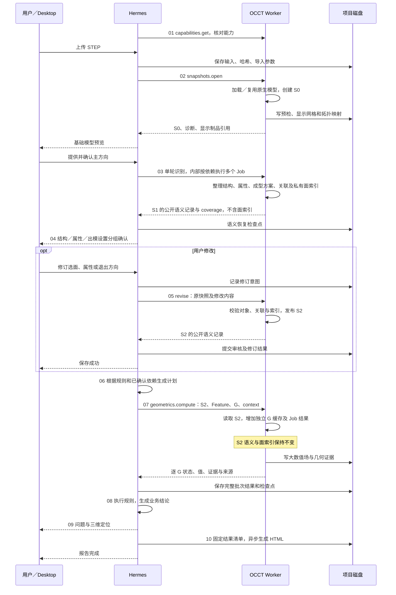

# DFM 系统架构与主流程

更新：2026-11-04。本文规定“一轮识别、快照统一存储、按组确认、按依赖计算”的开发流程。常驻模型、规则求值和异步报告沿用既有框架。既有单轮框架已按引擎 1.13.0 / bundle 2.4.0 联调；本次完整候选展示与统一方案编辑的验收状态、算法缺口及验证范围见[会话设计第 11 节](dfm-geometric-session-contract.md#11-单轮识别改造清单与验收)。旧两轮记录仅供迁移追溯。

## 主流程



预览不等待方向；模型可用且主方向已确认后启动单轮识别。“一轮”是一次业务识别阶段，内部仍按几何依赖执行多个任务或 RPC。当前同一 Worker 进程仅有一个几何 Job 执行线程，识别／成型／计算按队列串行，控制消息可同时处理；分析网格构建显式启用 OCCT 内部并行。单轮不等于所有算法并行，进程池仍是后续扩展。

识别期间持续显示进度与候选预览。所有请求的识别任务到达终态后，发布可审核的统一快照；未实现、失败和不确定项保留 coverage 与原因。分组确认从这份结果开始，不再安排固定的倒扣二次识别。

## 各阶段数据如何变化

S0、S1、S2 表示同一已加载模型上的语义版本。它们共享原生几何资源，不复制整个 OCCT 模型；同一快照的私有索引随语义状态固定。

| 阶段 | Worker 持有或新增 | Hermes 接收并维护 | 落盘内容 |
| --- | --- | --- | --- |
| 上传、打开 S0 | 原生模型、拓扑与查询资源；初始语义集合 | 模型身份、S0、预检及预览引用 | STEP、导入参数、预检、显示网格、拓扑映射 |
| 单轮识别 S1 | 结构、属性、成型方案、关联、coverage、私有 face_membership_index | S1 的公开语义投影，建立确认组；不接收面索引 | 识别恢复状态、来源及制品引用 |
| 用户修订 S2 | 同步更新对象、关联和私有索引；旧 S1 保留 | 通过版本校验提交 S2 投影、确认及相关依赖失效 | 修订意图、提交记录和语义检查点 |
| G 计算，仍绑定 S2 | S2 不变；新增查询缓存、G 缓存、Job 结果 | 完整逐 G 结果、质量、证据和来源；按身份汇总 | 大场、几何证据、各批结果与结果检查点 |
| 规则与报告 | 不将 Check、Finding、HTML 加入特征快照 | 规则结论、问题、Viewer、不可变结果清单 | 判定、定位、报告输入、HTML 与最终检查点 |

快照在 Worker 内存里的完整对象与公开响应是不同结构。Hermes 需要正向语义记录来确认、规划和显示，Worker 私有面索引不作为普通响应字段。重型方法先返回 job_id，终态数据通过任务事件或查询取得。

Worker 的 G 缓存用于重复计算加速，完整业务结果由 Hermes 持久保存。当前每模型 256 条缓存上限不限制特征数、测量总数或报告条目；淘汰后可重算，已返回的结果和证据仍须保留。

落盘贯穿整个过程；“结束归档”不表示此前只存内存。用户保存应答前提交恢复日志，发布大制品引用前保证文件完整，固定报告前核对结果与证据。原生 OCCT 指针、私有面索引和可丢弃的 G 加速缓存不要求直接序列化归档。

字段投影、批次提交与恢复责任见[会话设计 §9.7](dfm-geometric-session-contract.md#97-分阶段接收提交与归档)，Worker 内存结构及代码例子由其会话契约第 3.7 节维护。

## 系统由谁负责

| 组件 | 负责的工作 |
| --- | --- |
| Desktop | 上传、三维展示、按组确认、修改范围与方向、显示问题和报告 |
| Hermes | 项目事实、规则包、审核记录、快照投影、依赖计划、规则求值及异步报告 |
| OCCT Worker | 模型加载、单轮识别、快照及面归属索引、G 计算和几何证据 |
| Mold 本体规则服务 | 概念与规则的审核、发布和来源管理 |

Hermes 下载规则并安装为本地只读 SQLite。Worker 不接收 Check 阈值，不判断业务是否合格。二维图纸、产品属性和模具方案可补充输入；无法从几何可靠确定的用途与机构方案由用户确认。

## 贯穿实例：带孔 Boss 柱位于一个侧向成型范围

塑料壳体包含主体壁 `MAIN_WALL_0001`、带孔 Boss 柱 `BOSS_0007` 和根部圆角 `BLEND_0003`。主方向为 `[0,0,1]`；Boss 的部分外壁被识别为主方向倒扣面，方案候选为滑块范围 `SIDE_01`，退出方向为 `[1,0,0]`。

| 对象 | 本例的含义 |
| --- | --- |
| Feature | Boss、主体壁、圆角等结构实例；同一张圆角面可以同时是 Boss 的根部与圆角实例的组成面 |
| Annotation | 外观、定模／动模、型腔／型芯侧等独立属性 |
| Forming scope | 绑定一组产品成型面、机构类型候选及退出方向，不等于已构造真实滑块实体 |
| Snapshot | 固定一版结构、属性、成型方案、关联、coverage 和派生面索引 |
| Check | 业务指标，例如柱壁是否符合要求 |
| G | 技术指标，例如柱壁最大厚度及邻近主体壁参考厚度 |
| Face ID | `geometry_ref.entity_id`，来自所属拓扑快照，不是显示三角形编号 |

带孔 Boss 柱使用 `hollow_boss`，不以螺钉用途为识别前提。柱壁检查的两个 G 为 `G_HOLLOW_BOSS_WALL_THK_MAX` 与 `G_HOLLOW_BOSS_WALL_REF_THK`；公式和阈值来自规则包。

## 01 读取能力：知道本轮哪些对象能自动识别

Hermes 启动常驻 Worker，通过 `capabilities.get` 核对识别类别、G、所需输入和协议支持。单轮目标包括全部约定类别，但不能把尚未实现的外观或机构识别写成已支持。

缺少某项算法时，在同一识别结果中列明缺口并提供人工标注入口；候选方向、不确定机构和空列表均不能冒充已确认事实。新增范围字段与面索引的契约计划见[会话设计](dfm-geometric-session-contract.md#11-单轮识别改造清单与验收)。

## 02 打开模型：一次加载，多次使用

原始 STEP 保存到项目并记录内容哈希、单位及导入参数。Worker 通过 `snapshots.open` 加载模型，保留曲面、实体、拓扑、AAG 和空间查询资源；预览网格、拓扑映射及大数值场使用文件引用。

后续识别、用户修订及 G 计算继续使用这份已加载模型。语义快照和面归属索引在内存中版本化，磁盘 JSON 是恢复材料。Worker 退出后须重新建立原生对象并校验恢复状态。

`topology_map` 将稳定面引用映射到当前显示网格。换网格后重新投影高亮，不把三角形编号当作 Face ID。

## 03 一轮识别：一次整理三类结果

| 类别 | 本轮识别与整理内容 | 保存位置 |
| --- | --- | --- |
| 结构特征 | 主体壁、筋、实心／带孔 Boss 柱、孔、圆角链、倒角及其部位和参考关系；包含倒扣范围内的结构 | `features`、`relationships` |
| 属性标注 | 外观候选、定模／动模归属；保留型腔／型芯侧、分型边界等独立维度 | `annotations` |
| 出模情况 | 主方向范围、主方向倒扣面、对应滑块／斜顶成型范围候选、局部退出方向及不确定项 | `forming_scopes`、`coverage` |

Worker 内部顺序是“基础几何准备 → 全模型结构与主方向分析 → 局部方案候选 → 结构／范围关联 → 面索引 → 发布快照”。这是单轮内部的依赖顺序，不经过一次用户确认再重跑另一轮。

倒扣面是主方向下受阻的产品面，滑块／斜顶成型范围是拟由该机构成型的产品面集合，二者不能默认相同。一个成型范围还可包含无倒扣但需要一起成型的邻接面。

产品几何只能提供机构与方向候选。无法唯一确定时保留备选或空值，用户选择或补充；“已生成候选”不表示实际模具结构已确定。定／动模归属与型腔／型芯侧分别表达，不强行一一对应。未分类面保持明确的未分类状态。

### 按面查询：从面找到相关对象

本例的反向查询可读作：

```text
face-101 → BOSS_0007 外壁 + 外观属性 + SIDE_01 倒扣面／成型面
face-102 → BOSS_0007 根部圆角 + BLEND_0003 + SIDE_01 成型面
face-201 → MAIN_WALL_0001 自身面 + BOSS_0007 邻近主体壁参考面
```

`face-101` 是用于说明的面 ID 缩写；实际键直接使用拓扑映射的 `entity_id`，不再编号。值保留对象 ID 与归属角色，不复制整份 Feature 或几何模型。特别要区分“自身组成面”和“参与该特征计算的参考面”。

该索引按 `snapshot_id + topology_snapshot_id` 隔离，Worker 内部可据此快速找到面关联的对象。索引不随识别结果发送到 Hermes；前端依据公开正向面引用生成当前界面的导航表。它不能替代邻接、射线、厚度配对等算法，也不能证明识别清单完整。

## 04 分组确认：不设置第一轮、第二轮

| 大组 | 用户确认内容 | 就绪条件 |
| --- | --- | --- |
| 结构特征 | 结构实例、组成面、部位及参考关系 | 目标 Feature 与该 G 真正使用的参考对象已确认 |
| 属性标注 | 外观、定／动模归属等值与作用面 | 相关规则所需属性已确认 |
| 出模设置 | 每个范围的倒扣面、成型面、滑块／斜顶候选和退出方向 | 该成型方案完整并已确认；结构审核仍由结构组负责 |

同一 `SIDE_01` 使用一个成型方案确认组，不再要求依次经过“倒扣范围 → 局部结构 → 局部方向”三个阶段。范围内已经识别的 Boss、筋等只建立关联，在结构组确认，不重复建立或重复计数。

审核默认同时展示方案的倒扣面、成型面、机构与退出方向。完整候选可直接“确认方案”，无需先打开编辑器或另存一次草稿；“修改”才进入四项共用的方案草稿。局部方案列表支持“接受全部可确认方案”，只接受点击时完整且满足确认条件的待确认局部方案，不包含 MAIN、结构或属性组。

缺项方案显示具体缺少内容，允许补全、暂存或稍后处理，不代填机构和方向。批量接受跳过这些方案并保留待处理数量；候选数量不等于真实模具机构数量。确认组彼此不固定先后顺序，G 按实际依赖就绪：SIDE_01 缺方向时，普通组和 SIDE_02 可继续；方向无关的柱壁计算不因位于倒扣区域而自动等待局部方向。

Desktop 保留三个可折叠大组和“局部成型方案”快捷入口。点击三维面仍优先定位结构，再定位属性，最后定位出模设置；快捷入口可直接定位对应方案。已确认内容保留编辑入口，待确认数量为零时隐藏待确认区。

候选方向显示为待确认箭头；无方向时不显示其他方案的旧箭头。编辑时可修改两类面、机构和方向，一次确认完整草稿，或仅暂存而不确认。只有用户确认、写入 Worker 快照的有效方向才进入正式 G 的 context；主方向和局部退出方向分别保留，已确认 MAIN 不因审核局部方案而重新确认。

## 05 修订与失效：更新对象，同时更新索引

用户修改 Boss 组成面、外观属性、成型范围或方向时，Hermes 保存修订意图并携带版本提交 Worker。Worker 生成新语义快照，原快照与已派发任务保持不变。

- 移除面时，从受影响索引项撤下旧归属；新增面时加入新归属。没有归属的已知面保留空列表。
- 范围改变时，重算其与已有结构的关联；确有遗漏或依赖改变时做定向重评，不设置固定第二轮识别。
- 仅方向改变且面集合未变时，可复用面归属映射，仍须更新成型对象及方向结果的有效性。
- 主方向改变时重新评价依赖该方向的倒扣、成型归属和方案，保留无关结构与方向无关结果。
- 新快照在正向记录、关联与索引一致后才发布，Hermes 随后提交相同版本的投影与审核状态。

Hermes 通过 revise 修改权威对象，不接收或直接编辑 Worker 面索引。Worker 更新对象、关联与私有索引，Hermes 提交返回的公开语义投影；索引始终由权威记录派生。

## 06 查询规则并组织计划

```text
已确认 BOSS_0007 与其参考主体壁
  → Feature → Check → Operand → G
  → 根据材料、外观等 Fact 选择规则
  → 固定快照、规则发布版本与依赖指纹
  → 合并相同 G 需求，生成就绪计划片段
```

Run 固定模型和规则版本，各组就绪即可追加不可变计划片段；修订后追加替代片段。Worker 不接收业务公式和阈值。字段与求值见[本体规则契约](dfm-rule-catalog-database-design.md)。

## 07 测量技术指标：直接消费已识别的部位

Worker 按 `snapshot_id + feature_id + geometric_id + context` 查对象与部位。柱壁 G 选择 Boss 外壁和孔壁，参考壁厚 G 沿关联查局部主体壁；根据面起步的查询利用面归属索引定位对象。需要邻接或配对时继续查询完整模型。

这一步不重载 STEP，也不重新识别覆盖人工修订。G 的参考、聚合、单位和有效域固定；不能用全件平均值替代局部壁厚，不能因使用面索引就静默裁剪整特征指标。

数值、质量、见证点、拓扑证据和来源一起返回。G 结果独立于特征快照保存，计算结束仍绑定输入快照；不会仅为增加一个测量值派生新特征版本。共享有效 G 结果并按有界批次发布，失败或不适用保留原因，不填零。工程口径见[带孔 Boss 柱实例](注塑件%20DFM%20A类特征区域与%20Check-Geometric%20映射%20V1.0.md#2-用带孔-boss-柱还原完整模型)。

## 08 执行规则：技术指标组成业务结论

柱壁最大厚度 2.1 mm、参考主体壁厚度 3.0 mm，比例为 0.70；若所选规则上限为 0.60，就形成一个“柱壁”问题。实际公式与阈值来自规则，不由测量端补写。

组内 AND、备选组 OR 和缺值处理遵循规则执行器；没有运行或输入缺失不能默认通过。问题按业务类型统计，严重程度展示仍留作后续扩展。

## 09—10 问题先展示，报告后台生成

Check 可判定就发布问题与三维定位，HTML 交给后台任务。只有部位证据时显示黄色初步定位，精确证据完成后更新红色区域；颜色表达定位阶段。

高亮使用几何证据与当前匹配网格。参考主体壁参与柱壁比例计算，不意味着它应和违规柱壁一起全部标红。报告固定 `result_manifest`，保留规则、结果、快照、网格和未完成项；报告失败可独立重试。

## 存储与开发入口

Worker 内存持有原生模型、不可变语义快照及派生面索引。Hermes 内存持有同版公开语义投影、审核、计划和结果；两端通过接口交换数据，不共享可写 Redis 对象或 C++ 指针。恢复日志在关键操作提交时落盘，网格、场和报告放受控文件；只读 SQLite 用于规则包。

代码改造、字段与验收见[Hermes 会话设计](dfm-geometric-session-contract.md#11-单轮识别改造清单与验收)。主流程不重复维护完整 Schema，文档导航见 [README](README.md)。
