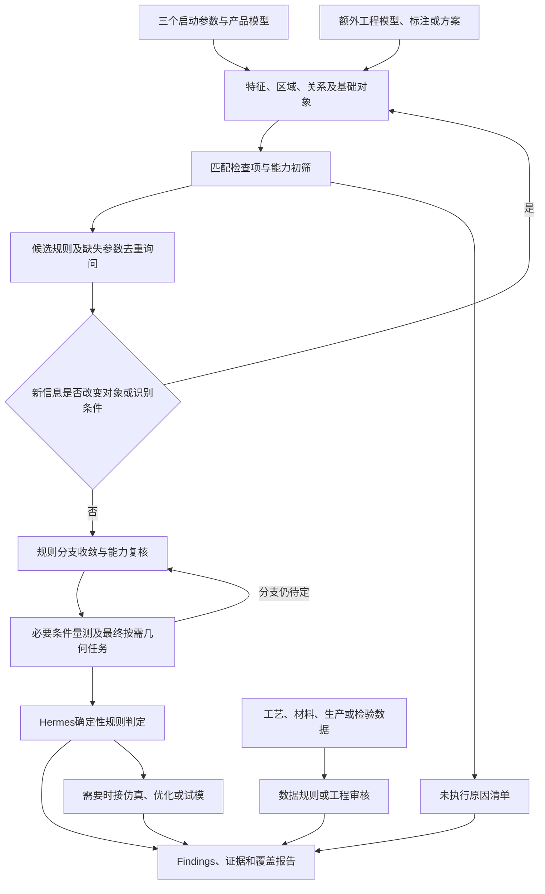

# 注塑件 DFM 清单分类与技术覆盖评审 V1.0

评审日期：2026-09-28，按用户明确的技术方案修订。来源：[工程检测与几何计算清单](注塑件%20DFM%20工程检测与几何计算清单%20V1.0.md)，19类、171行。逐项结论见[覆盖矩阵](注塑件%20DFM%20检查项覆盖矩阵%20V1.0.md)。

**结论：这条“特征/区域→检查项→能力筛选→规则与参数→按需几何计算→确定性判定”的主流程是合适的，可作为产品几何DFM的核心方案。** 筋厚比、BOSS壁厚、孔距、根部R、拔模等即使尚未实现，也属于该方案能解决的问题。方案边界不应由当前代码和默认规则包的数量决定。

产品几何以外的项目要区分两种情况：一类只是缺少模具、配合件或面级标注，补充输入并重新关联后仍可走相同几何流程；另一类需要物理预测、业务数据或方案优化，应接入其他分析路径，最后汇总证据与报告。

## 1. 评审口径与覆盖结论

### 1.1 以技术方案为准

本次不再用“已实现/未实现”标记清单。假设所需语义识别、区域关系、几何算法和工程规则可以逐项开发；“capabilities未提供某算法”仅表示当前运行不能执行，不意味着该项超出方案的技术边界。

方案依据是用户本次给定的流程，并参考工程中的[本体与规则设计](dfm-rule-catalog-database-design.md)和[系统架构](dfm-system-architecture-and-data-flow.md)。下面涉及调度细化与其他分析路径的内容是设计建议，不声称已经落入代码或当前Schema。

本次直接修正源清单的输入时机、距离/拔模定义和少数明显不准确的计算描述；不改原检查项名称和行数。先前评审中的代码版本、EXE能力统计和测试记录不再作为本报告覆盖结论的依据。

### 1.2 清单按方案分流

| 类别 | 原清单行数 | 代表项 | 方案结论 |
| --- | --- | --- | --- |
| A 主流程可判 | 44 | 壁厚、筋/BOSS尺度、R、孔距、拔模、指定方向的脱模评价 | 特征/区域/关系明确后，计算几何量并执行规则 |
| B 补对象可判 | 70 | 真实薄钢、机构干涉、顶出落点、外观禁区、公差链、工艺可达性 | 增加结构化工程对象及关联，仍复用主流程 |
| C 主流程仅预筛 | 39 | 充填平衡、困气/熔接、冷却/翘曲、脱模力、焊接/包胶效果 | 几何风险规则可判；关键物理结论要接外部求解或验证 |
| D 数据/审核支路 | 18 | 材料属性/配比、过程能力、银丝/色差/光泽、维护寿命 | 以Fact、证据、统计模型或工程审核评价，可按需复用几何量 |

这些是171个原始行的主要路径，不是独立Check数量或软件完成率。A/B的“可判”只针对列出的几何/约束条件；对强度或量产后果不作保证。“GF材料”“模具寿命”等宽泛条目必须先拆为原子检查，可能同时进入多个路径。

## 2. 原清单分类是否合适

### 2.1 适合工程讨论，不宜直接作为检测引擎目录

原分类基本覆盖了产品设计到模具量产的主要议题，适合作为评审会议提纲。问题在于分类轴不一致：

| 问题 | 原清单例子 | 建议 |
| --- | --- | --- |
| 结构、过程和后果同级 | “孔槽”“流动充填”“外观质量”并列 | 用唯一 Check 管理判定，用多个标签组织工程视图 |
| 同一几何项重复出现 | 盲孔底厚 01.09 / 12.03；皮纹拔模 05.08 / 16.01 | 共享 Check 或检查族及 Measurement，保留来源条目别名 |
| 几何指标与功能语义混合 | BOSS壁厚 01.07 / 螺丝BOSS壁厚 11.01 | 共用厚度算子；螺钉用途、螺钉规格和承载规则分开 |
| 原因与结果重复计数 | 厚肉、热岛、缩痕；浇口残痕、浇口印 | 建立“几何证据→风险→影响区域”关联，合并同源问题展示 |
| 条目过宽，缺少可执行谓词 | “GF材料”“热流道适配”“模具寿命” | 拆为原子检查，每项说明比较对象、输入、算法和结论类型 |
| 同类各行重复套用计算描述 | 顶出、材料、二次工艺等表格 | 改为逐项计算：面积、碰撞、材料核查不能共用一句模板 |
| 数据前提没有进入调度 | 钢料、顶针、水路、公差仅在文字中要求 | 输入缺失形成待补条件；不能自动跳过后报告“通过” |

171 是原始行数，包含重复和宽泛条目，不是 171 个独立、可直接执行的算法。不能简单按同名去重：例如“皮纹拔模”可统一，但“外观皮纹拉伤”仍需要外观等级与实际表面质量证据。

### 2.2 推荐的业务分类

保留原 19 类作为兼容视图；新目录采用以下主分类。原条目可有多个标签，主分类只决定归属，不决定算法重复执行。

| 新主类 | 内容与原分类映射 |
| --- | --- |
| C0 输入与模型质量 | 单位、实体闭合、几何容差、拓扑、模型版本、输入适用性；原清单缺少独立入口 |
| C1 产品几何与局部结构 | 壁厚、厚肉、圆角、筋/BOSS/孔槽/卡扣/止口尺寸；原 1、6、11、12 的几何部分 |
| C2 脱模与成型分区 | 方向、拔模、倒扣、分型、插破/靠破；原 4、5 的静态可脱模部分 |
| C3 模具结构与制造维护 | 钢料、抽芯机构、加工、拆分、维修；原 3、4 机构部分、17、19 |
| C4 浇注、充填与排气 | 浇口、流路、多腔平衡、困气、熔接；原 2、7、8 |
| C5 冷却、收缩与变形 | 水路、热岛、收缩、翘曲；原 9 |
| C6 顶出与取件 | 顶出布局、接触面积、运动干涉、脱模力；原 10 |
| C7 功能装配与尺寸质量 | 装配间隙、配合、公差链、强度、基准；原 11 功能部分、13 |
| C8 外观与表面工艺 | 外观面等级、痕迹禁区、纹理、抛光、涂饰；原 15、16、18 表面工艺部分 |
| C9 特殊成型与连接工艺 | 螺母植入、焊接、胶粘、嵌件成型、包胶；原 18 其余部分 |

**材料原第 14 类主要提升为横向 Factor 层**：牌号、增强比例、结晶性、阻燃要求、含水率等影响多个 Check。材料合规或数据完整性可以保留独立检查，但“GF材料”本身不是一个几何缺陷。

同时为 Check 设置四个检索维度：对象（整件/特征/关系/装配/模具/过程）、输入（CAD/语义/方案/工艺记录）、方法（几何/规则/仿真/人工或实测）、结论（几何合规/风险预筛/仿真预测/实测验证）。这些先作为目录字段或受支持的元数据，不意味着必须新增本体表或立即修改现有 Schema。

## 3. 对给定主流程的评审与必要细化

### 3.1 保留原有顺序

| 步骤 | 用户给定流程 | 建议补充的执行语义 |
| --- | --- | --- |
| 1 | 询问工艺、模型单位、主出模方向三个启动参数 | 已有可信值可展示确认；方向统一到模型坐标，不默认猜测。未知方向可先做无方向检查，方向相关项待补 |
| 2 | OCCT识别并返回语义特征和区域 | 同时返回整件/未分类区域、根壁顶底等部位、特征间关系及识别覆盖信息；识别内部允许必要基础计算 |
| 3 | 按已识别特征筛选检查项 | 用“工艺＋对象类型＋区域角色＋关系”匹配；整件检查无需先识别成筋/BOSS，功能用途可保留候选并询问 |
| 4 | 与OCCT capabilities取交集，排除算法未实现项 | 初筛检查的可行计算方案，不是直接对Check ID和算法ID取字符串交集；暂不可执行项留在覆盖账本 |
| 5 | 筛选候选规则 | 按已知业务条件排除明确不适用项；缺参数/缺几何条件的规则保持待定，不能当false |
| 6 | 合并去重，询问候选规则缺少的业务参数 | 按参数ID＋对象作用域＋单位/版本去重，按条件分支逐批询问；不为明确不可执行项询问无用参数 |
| 7 | 确定最终适用规则和Geometric ID | 仅Fact条件的规则此时可确定；依赖几何值的适用条件需要小规模前置量测后再定分支 |
| 8 | OCCT只执行相应几何算法 | 按Geometric→metric/quantity/算子映射执行，包含必要依赖闭包；对条件量测和多个Check重复用到的任务去重 |
| 9 | Hermes按规则判合格/不合格 | 校验输入、单位、作用域、精度和结果有效性；执行表达式/关系谓词/阈值，缺数据不出pass/fail |
| 10 | Findings、证据、报告 | 同时输出已判项、预筛项、待补输入/算法/审核项；结论标明几何合规、物理预测或实测验证 |

业务材料、纹理、客户标准等后询问的安排合理，不必回到“上传模型就问完所有参数”。需要改变识别域或新增对象的资料是例外：例如局部纹理面、模具组件、侧抽方向，在补入后更新Feature/Region及受影响的识别结果，再重做检查匹配。

### 3.2 特征筛选要能表达整件和关系检查

“特征”不应只指孔、筋、BOSS等命名结构，还应包括可供规则绑定的分析对象：

| 目标类型 | 例子 | 在主流程中的表达 |
| --- | --- | --- |
| 整件/基础区域 | 全件最薄区、均匀性、未知结构的侧壁 | 每个输入实体自动建立part/body及有效区域；这些目标进入相同Check筛选 |
| 命名特征的局部区域 | 筋根、BOSS壁、盲孔底 | Feature＋Region角色，指定精算范围 |
| 关系/组合对象 | 筋与相邻主壁、两个孔、筋交汇、对称区域 | 实例关系或复合区域；Operand分别绑定参与对象 |
| 外部工程对象 | 顶针、滑块、配合件、纹理/外观面 | 导入或人工圈选，绑定稳定模型/区域身份后参加匹配 |
| 非几何对象 | 材料批次、工艺记录、公差要求、寿命目标 | 触发数据规则支路，无须伪装成几何特征 |

这不要求提前执行所有DFM算法。比如“最大壁厚”可先绑定整件有效域，再按需生成厚度场；厚肉可以在后续量测中生成派生问题Region。识别阶段所需的拓扑、法向、曲率、粗尺度计算属于识别依赖，与“正式检查按需精算”不冲突。

未识别到某结构不能直接解释为不存在。区分“确认无此结构”“识别未覆盖/不确定”“局部角色待确认”；后两者可用人工选面、CAD原生属性或后续识别补充。特别是“缺少应有结构”的检查，应从父特征触发，例如从BOSS触发支撑检查，再判断是否存在加强筋；不能等识别到加强筋才创建这项检查。

### 3.3 capabilities应按依赖匹配，并保留两次判断

Check与Geometric通常是多对多关系，Geometric ID也不等于C++函数名。建议匹配条件包含：输入类型、目标类型/区域角色、所需quantity和单位、方向参数、结果证据及算法适用域。

```text
阶段一：特征匹配后的Check候选
  → 查询该Check允许的计算方案及依赖
  → 至少存在一套可行方案才保留为可执行候选
  → 没有方案则记录unsupported，停止该支路的无效参数询问

阶段二：业务参数明确、规则分支选定
  → 校验这条规则的所有必需Operand/quantity及依赖均可执行
  → 固定目标、参数、规则与能力版本，编译实际几何任务
```

若Check只有一种固定计算方案，步骤4即可完成大部分能力判断；若不同材料或规则分支使用不同Geometric，就要保留待定支路到规则筛选后再次校验。不能因为某个不适用分支的算法缺失，就排除整个Check；也不能只因支持其中一个Operand，就声称整条规则可算。

这种细化保持“先能力筛选，再询问业务参数”的节约目的。输入尚未提供与算法不存在是两类状态；B类检查应进入待补对象清单，而不是被误判为OCCT无法承载。

### 3.4 几何适用条件需要两阶段量测

例如规则为“当筋高厚比大于阈值时，适用另一拔模要求”。高厚比本身需要计算，因此不能在任何几何计算前确定最终规则。

合理顺序：先选候选规则 → 计算决定分支的必要几何量 → 收敛适用规则及剩余参数 → 仅计算剩余量 → 判定。若所有适用条件只依赖用户Fact，则直接走原来的单阶段流程。计划编译需检测条件循环，避免“是否计算X取决于尚未得到的X是否合格”。

### 3.5 三个启动参数的作用边界

三个参数足以启动产品几何识别，但不保证完成所有业务语义识别。圆柱形凸台可能是螺丝柱、定位柱或普通凸台；识别阶段可返回几何类型和用途候选，后询问用途再细化检查。主出模方向只约束主开模，滑块/斜顶仍需局部运动方向。

“询问主出模方向”与“自动推荐最优主出模方向”是两种任务：本流程可评价给定方向，推荐方向则在外层枚举/搜索多个候选，调用该流程比较后由工程师选定。



## 4. 能解决哪些检查项

### 4.1 直接属于主流程的产品几何检查

| 检查族 | 对应原清单编号 | 配合计算 | 可给出的结论 |
| --- | --- | --- | --- |
| 壁厚与厚肉 | 01.01—01.10 | G1厚度分布、极值、过渡；G4相邻/交汇关系 | 尺度、比例、过渡是否符合规则 |
| 方向评价与倒扣几何 | 04.01—04.04 | G2可见性/遮挡；G5定向深度 | 给定方向下的脱模几何、倒扣区域及超限；最优方向搜索/机构方案另验 |
| 几何拔模 | 05.01—05.07 | G2角度场、局部方向、区域合并 | 内外壁、筋/BOSS/卡扣侧壁角度是否合规 |
| 圆角 | 06.01—06.06 | G3 R/曲率；G4根部归属；G1局部厚度 | R、R/t及过渡几何是否合规 |
| 产品几何不对称 | 09.01—09.02 | G1厚度；G4/G8布局与区域对应 | 对指定比较基准的几何差异 |
| 局部结构尺寸 | 11.01—11.02、11.04、11.06—11.08、11.11 | G1/G3/G4/G5 | 螺丝柱壁厚、支撑关系、间距、长度、根厚、止口厚等几何规则 |
| 孔槽与细小特征 | 12.01—12.08 | G4孔底/开口/有效长；G5净距；G1底厚 | L/D、H/W、净距、底厚、最小尺度规则 |

共44行；重复的盲孔底厚保留追溯，但计算去重。材料、表面要求、功能用途等可在特征匹配后按候选规则询问。它们改变阈值或规则适用性，不必改变主流程结构。

### 4.2 补工程对象后继续用同一流程

| 额外输入 | 对应检查例子 | 为什么不能只靠产品识别 | 补充方式 |
| --- | --- | --- | --- |
| 面级外观/纹理与成型分区 | 05.08/16.01、15.03—15.07、16.03 | 面的用途和等级不是唯一几何属性 | 图纸/PMI解析或人工选面，建立Region属性和边界 |
| 模具负形及真实组件 | 03类、04机构部分、17制造维护类 | 产品模型不能唯一确定钢料、支撑和分件 | 导入模具模型；早期可用已确认简化方案，结论限于该方案 |
| 运动与工具模型 | 04.05—04.11、10.07、16.04、17.01 | 运动路径、行程、时序和有限尺寸工具不在单件外形中 | 提供实体/包络＋运动约束，执行G7 |
| 顶出/浇口/排气方案 | 07.01/07.05/07.07、08.08、10几何项 | 位置、类型、足迹及通路是方案选择 | 标注候选或导入模型，验证位置、面积、间隙、可达性 |
| 装配、标准件、图纸 | 11配合类、13跨分件/公差链、18连接工艺几何项 | 缺配合件、规格、公差、基准与工艺设备 | 结构化导入和关联，运行相同Operand/几何/规则路径 |

“补对象”包含轻量标注，不要求每项都上传完整模具。全件统一皮纹只需后询问规格；局部皮纹需面级范围。螺丝柱已被可靠确认用途时，可直接询问螺钉规格；用途不明确时先确认并重新筛选相关检查。

这70行也不是70个完整工艺结论。例如可验证热板焊接的面积、间隙及设备运动空间，但焊缝强度仍需工艺验证。原清单名称应拆成这些可执行子检查。

### 4.3 几何预筛可以有pass/fail，但它不是物理结论

“筋厚比超限”可输出不合格，同时形成“背面缩痕风险”；“筋厚比通过”只证明该几何规则通过，不证明零缩痕。同理，高径比、水路距离、流长比、低拔模区均可提供确定性几何检查，但不能单独确认型芯强度、冷却温度、充填压力或脱模力。

建议为宽泛条目拆成明确的`几何预筛Check`与`物理/实测验证Check`，在报告里关联显示。没有后者的证据时不能把前者的pass扩大成整个条目的pass。

## 5. 需要配合的几何计算

以下 G0—G12 是**本文的能力分组编号**，不是接口 ID。矩阵用这些编号定位可复用算子；具体量及其 quantity 名称须在 Worker 能力清单和本体绑定两端明确发布。

| 编号 | 输入和计算 | 输出与边界 |
| --- | --- | --- |
| G0 模型质量与身份 | B-Rep有效性、闭合/方向、单位、容差、连通体、面边邻接、几何与网格映射 | 可计算域、失效区域、稳定快照；修复前后须保留映射，不静默改变产品意图 |
| G1 厚度场与厚肉 | 内外面配对、法向射线/截面、局部内切球或等价体积分析、有效样本统计 | t_min、t_max、代表厚度、厚度比/梯度、厚肉区域；区分薄壳厚度与根部实体堆胶 |
| G2 拔模与方向可见性 | 面法向＋局部成型方向、带符号角、遮挡、多方向分类、区域合并 | 角度场、零/反拔模区域、不可见域；必须区分主开模、滑块与斜顶方向 |
| G3 曲率、圆角与夹角 | 凹凸边、解析圆角/拟合、主曲率、连续性、根部归属 | 最小R、R/t、夹角；曲率半径不总等于设计圆角半径 |
| G4 特征尺度与关系 | 孔/槽的轴线、截面、开口/底面；筋/BOSS/卡扣的根壁顶；attached_to、adjacent_to | L/D、H/W、根厚比、有效长度、局部主壁关系；孔形不能证明它是螺钉孔 |
| G5 距离、间隙与对应 | 指定对象/区域之间的最小距离、定向距离、净距、投影与背面映射 | 孔边距、孔孔净距、BOSS外壁距、装配间隙、外观背面对应；不能用中心距替代净距 |
| G6 模具负形与钢料 | 在确认的模具分区/毛坯中做布尔差、分件、截面、支撑与局部厚度分析 | 真实钢厚、钢高、细芯支撑长度；仅产品CAD时最多给候选负形风险 |
| G7 运动与可达性 | 模具/装配/刀具实体、方向、行程、时序；扫掠、连续碰撞、净空 | 最小脱离行程、干涉部位、工具可达区；终点不碰撞不能证明全程无干涉 |
| G8 面域、边界与布局 | 区域面积、边界相交、足迹投影、重心、可用区域与对称性 | 顶出接触面积、痕迹禁区相交、纹理截止线、布局偏心；面积平衡不等于力平衡 |
| G9 流路几何代理 | 中面/体域连通图、浇口种子、通道截面、路径与分支、汇合候选 | 流长/厚度、瓶颈、几何远端；不是实际填充时间、压力或熔接痕结果 |
| G10 热与变形几何代理 | 厚度分布、局部体积/面积比、筋布局、水路距离和对称性 | 热岛、冷却不均、翘曲敏感区域；不能输出温度、变形量或周期保证值 |
| G11 尺寸与装配语义 | PMI/图纸、基准、面关联、成型分区、配合约束、公差链图 | 名义尺寸、跨分件标签、极值链/统计链输入；CAD名义尺寸不是实物测量 |
| G12 工艺界面与路径 | 焊缝/导能筋/搭接/包覆界面、胶层、路径、工具足迹、边缘厚度 | 界面面积、截面、间隙、连续性、可达性；结合工艺窗口才可判定适用性 |

### 5.1 几个需要明确的计算定义

- **厚度**：一般最小面距只是候选；相邻共享边会给出零距离，内外非对向面会给出错误厚度。对壁厚需验证对向性和连接段位于材料内；对装配净距则要测间隙，不能机械套用“连接段在实体内”的筛选。OCCT 的距离 API 提供通用最短距离及见证点，工程语义需上层定义。[OCCT 距离 API](https://occt3d.com/dev/doc/refman/html/class_b_rep_extrema___dist_shape_shape.html)
- **筋厚比**：`t_rib_root / t_adjacent_wall`。分子与分母都要指向同一筋实例附近的明确区域；不能用全件平均壁厚作所有筋的分母。
- **带符号拔模**：可用 `asin(clamp(n·d_local, -1, 1))` 表达局部角度基础，前提是已经统一实体法向和该侧成型方向；另一半模方向与符号需相应处理。单独负号不等于真实倒扣，必须结合可见性和机构方案。
- **深径比**：`L_effective / D_effective`。盲孔底部锥尖、沉孔、阶梯孔不能与直孔有效成型段混算；型芯强度还取决于单端或双端支撑、压力和钢材。
- **均匀性**：建议保存分区后的 t_min/t_max、分位值、相邻过渡比和 `|Δt|/Δs`。比值的取样邻域、Δs 和异常面积门槛必须固定；不能只比较全件极值就定位“突变”。
- **流长比**：等厚通道可用 L/t 作代理；变厚通道可研究 `∫ ds/t(s)` 等几何指标，但必须注明定义并校准，不能直接将它当作熔体压降或材料标准流长比。
- **模具钢料**：两孔之间往往是塑料，产品槽对应的负形才可能形成凸钢。必须先确定材料域和模具域，不能将“所有小距离”统一标注薄钢。
- **精度**：场极值必须附带采样间距、网格误差、无效样本比例、搜索收敛信息。无法确认的小区域标记待复核，不用“采样未检出”代替“缺陷不存在”。

## 6. 主流程之外的补充方案

| 路径 | 适用条目 | 执行方式 | 与主流程的结合点 |
| --- | --- | --- | --- |
| 物理仿真/工程计算 | 充填、熔接/困气、冷却/收缩/翘曲、包紧/顶出力、结构强度 | CAD与材料模型、网格、载荷/工艺边界 → 流动/热/结构求解 → 结果校验；简单问题可用经验证解析模型 | 复用几何和定位，独立Solver capability；结果回到Hermes执行相应物理规则 |
| 业务资料规则核查 | 材料适配、再生料比例、认证适用范围、公差能力 | 项目/材料/批次Fact → 候选规则 → 缺失资料补充 → 表格/表达式比较 | 无几何Operand时跳过OCCT，不经过纯几何capability筛除 |
| 检验、试模与生产数据 | 银丝、光泽/色差、实际变形、磨损、维护周期、模具寿命 | 导入报告、照片、尺寸/色差/光泽测量、模次/维护记录；统计/经验模型或人工审核 | 保留产品/模具版本、批次、测量条件和证据来源，汇总入报告 |
| 工程语义确认 | 功能角色、外观面、纹理区、基准合理性、模型漏识别 | 图纸/PMI/原生CAD元数据＋人工选择/确认；LLM可解释提议但不能编造几何事实 | 形成Fact/Region或审核记录，必要时重入识别/规则筛选 |
| 方案生成与优化 | 推荐出模方向、浇口位置/数量、机构布局、镶件拆分 | 候选方案生成 → 调用几何/仿真评价 → 成本/外观/制造约束排序 → 工程确认 | 主流程是单个方案的评价器；优化搜索是外层循环 |

### 6.1 仿真并非只能做成大规模自动集成

可以先允许导入已有仿真结果/工程报告，记录材料、求解条件和模型版本；有稳定使用场景后再接自动求解。结果字段必须说明是几何量、物理预测还是实测量，不能把压力/温度/变形偷偷装成OCCT几何算法输出。

流前沿、压力、温度、困气和熔接线属于注塑仿真的不同结果；熔接质量还受工艺条件影响。这支持把几何路径指标与物理验证分开，而不是将“路径等长”直接判为充填平衡。[Autodesk 注塑仿真结果](https://help.autodesk.com/cloudhelp/ENU/Fusion-Simulate/files/SIM-FIM-VIS-STD-RESULTS-CPT.htm)、[Autodesk 熔接线说明](https://help.autodesk.com/cloudhelp/2024/ENU/MoldflowComm-CLC-Troubleshoot/files/Troubleshooting-molding-problems/LM_WELD_AND_MELD_LINES.html)

### 6.2 纯业务检查仍可自动化

例如“再生料比例≤已审核上限”，Operand来自投料记录或确认Fact，不来自CAD。只需资料、单位/版本和适用规则齐全，即可由Hermes确定性判定。不能因为没有Feature或Geometric ID就认为DFM系统不能检查；需要的是独立触发入口和可为空的几何任务集合。

材料、公差能力、可靠性领域的宽泛条目也需拆分：供应商推荐收缩范围是资料核查，该件真实各向收缩需仿真/试模；维护记录完整性可直接查，预计模具寿命则需数据模型或工程评估。D类不意味着每项都能仅凭一个用户输入数值判定。

## 7. 主流程必须保留的结果与依赖契约

### 7.1 检查、规则、几何量各自负责什么

| 对象 | 最少需要表达的内容 |
| --- | --- |
| Check | 目标类型/区域角色/关系、工艺范围、允许的计算方案、结论类型、原清单映射 |
| Rule | 业务适用条件、可能的几何适用条件、Operand、表达式/谓词、阈值、单位和依据 |
| Geometric | 技术量定义、量纲/单位、输入对象、区域选择、聚合口径、Worker映射及依赖 |
| Capability | 支持的输入/对象/quantity、算法版本和适用域、精度/资源限制及证据输出 |
| Fact/Observation | 参数身份、全件/特征/面级作用域、来源、确认状态、版本和有效条件 |
| Measurement | 目标、值/场、单位、计算方法、误差/有效样本、模型/区域/算法身份 |
| Evaluation/Evidence | 规则与Operand回链、适用条件、结果类型、几何/仿真/实测证据和未判原因 |

这些是语义要求，优先复用现有本体和契约字段；新增字段应按具体检查消费者逐项扩展。OCCT只返回客观值、区域和诊断；Hermes程序决定规则适用性及判定，LLM负责交互、解释和有依据的建议。

### 7.2 缓存和去重应按对象作用域

参数去重不是按显示名称合并。例如两个纹理区可能有不同纹理规格，两个机构有不同抽芯方向。计算去重使用“Geometric＋目标/区域＋输入版本＋几何参数＋算法版本”；同名厚度量在不同筋根上仍是不同任务。

只改变不影响几何的材料阈值时可复用Measurement；改变方向、模型、面级归属或算法时重算相关识别/量测；材料进入流动物理模型时也必须使对应求解结果失效。一次运行固定规则/事实/能力版本，不能混合新旧模型上的Face引用。

### 7.3 从执行计划排除，不从覆盖报告消失

| 结果状态 | 使用条件 |
| --- | --- |
| 已判：通过/不通过 | 所需对象、输入、量测和规则有效，结论限定在该Check范围 |
| 风险预筛 | 几何代理或经验规则已有结果，物理/实测结论尚未验证 |
| 待补对象/参数 | 需要图纸、区域关联、模型、方向、材料等输入 |
| 本次能力不支持 | 所需识别器/量测/求解器不在本次能力清单中 |
| 无适用规则 | 已知输入条件下没有可用规则，不能按默认合格处理 |
| 识别不确定/需审核 | 无法可靠确定对象角色、区域或工程意义 |
| 不适用 | 有明确事实证明无需检查该项；未检出特征不是充分理由 |
| 计算失败/结果无效 | 超时、拓扑错误、采样覆盖不足、单位或精度异常等 |

这些是建议的业务状态语义，不声称当前枚举已经全部实现。最终报告同时汇总A/B几何检查、C预筛/验证、D资料/审核。能力筛除不能让用户误以为整份清单已经检查完毕。

## 8. 建议的落地顺序与源清单修订

1. 按原子Check整理清单，优先完成A类及可轻量补参数/标注的B类；不按现有代码支持数量限制设计范围。
2. 明确整件、局部Region、关系、缺失结构检查的触发方式；完善能力初筛、规则分支及按需几何依赖编译。
3. 对模具、配合件、局部纹理/外观、PMI等提供输入和确认方式，让B类自然重入同一主流程。
4. 为C类先建立明确的预筛规则与结果导入；按项目需要接物理求解或方案优化。
5. 增加不依赖几何特征的Fact/证据检查入口，承接D类，统一输出覆盖状态。

原清单仍保留19类作为工程阅读视图；其使用说明改为三个启动参数和业务参数按需补充，修正“所有最小距离都必须排除共边”的泛化、侧壁拔模角定义、主方向验证与推荐的区别，并明确薄钢阈值只是经验预筛。对明显套用模板的筋交汇、BOSS根连接、盲孔底厚等条目给出更准确对象和计算。

本次修改仅涉及三份文档；没有调整运行代码、默认规则或能力清单，也不以之前运行的单元/E2E测试代替本次方案覆盖论证。
